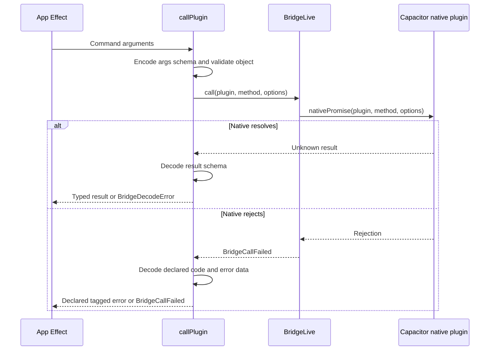

The WebView and native shell run in different runtimes. Capacitor transports calls; Radical's `Bridge` service gives those calls an Effect error contract.

## A manifest command across the bridge

Invalid arguments fail before transport. A missing native bridge produces `BridgeUnavailable`.

Unknown rejection codes and invalid error data remain `BridgeCallFailed`, so an unexpected failure cannot masquerade as a declared capability error.

## Shell commands and releases

Each installed shell reports its shell commands before page scripts run. If the list does not contain a command, the bridge fails with `BridgeUnavailable` without calling native code. Shells without a list keep the previous bridge behavior.

In remote mode, every release loads the newest UI. That UI can call commands missing from older releases. Checking the list avoids probing a missing Capacitor method, which can leave the call hanging.

## Runtime selection stays replaceable

Capability operations select native commands or browser services when the Effect runs. Browser services use web APIs; default Google sign-in and native push have no browser equivalent.

Injectable layers let tests replace the bridge and browser services without a native project. React hooks start Effects after mount and release owned work on unmount.

See [Client reference](/docs/reference/client) for services and errors, or [Plugin manifests](/docs/reference/plugins) for command schemas.
