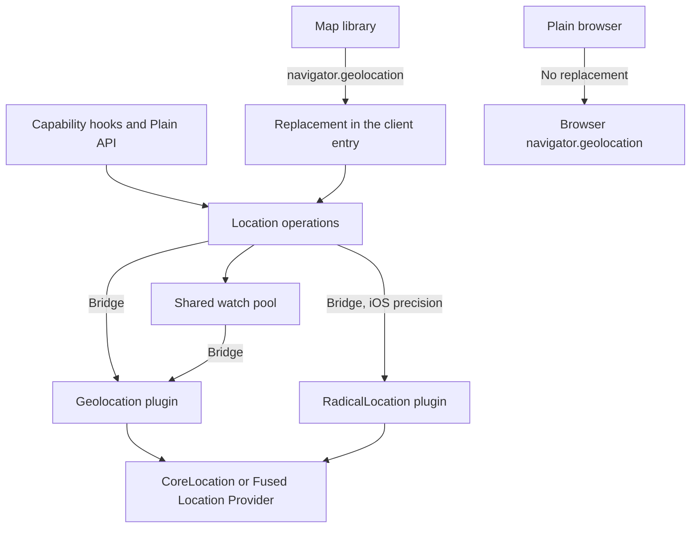

<Callout type="info">

The location capability is available in `@akshatowo/radical` 0.3.0 and later.

</Callout>

A web page reads location through [`navigator.geolocation`](https://developer.mozilla.org/en-US/docs/Web/API/Geolocation_API). In a shell, that API runs inside WKWebView or Android WebView, and both depend on the app to finish the job.

Without the right declarations and delegate code, the call fails. With them, the user still sees extra prompts, and the page cannot tell location precision or location services from permission.

The native location APIs answer those questions. Radical's Location capability calls CoreLocation on iOS and the Fused Location Provider on Android through the Capacitor Geolocation plugin and a small Radical plugin.

The shell then installs a `navigator.geolocation` replacement backed by the same calls, so map libraries keep working.

## Location calls in a shell

## What the WebView API can and cannot do

The table compares `navigator.geolocation` in WKWebView on iOS 17 to 26 and in Android WebView with the native APIs. "App code" means code the app developer writes in Swift or Java.

| Capability | WKWebView, iOS 17 to 26 | Android WebView | CoreLocation | Fused Location Provider |
| --- | --- | --- | --- | --- |
| Works without app code | No. The app needs [`NSLocationWhenInUseUsageDescription`](https://developer.apple.com/documentation/bundleresources/information-property-list/nslocationwheninuseusagedescription), because [WebKit asks CoreLocation first](https://github.com/WebKit/WebKit/blob/main/Source/WebKit/UIProcess/ios/WKGeolocationProviderIOS.mm). | No. The app needs [location permissions](https://developer.android.com/develop/sensors-and-location/location/permissions/runtime) and an [`onGeolocationPermissionsShowPrompt`](https://developer.android.com/reference/android/webkit/WebChromeClient) handler, which runs only for secure origins. | Yes, with a usage description | Yes, with location permissions |
| Prompts | The app prompt, then a [second prompt for the page](https://github.com/WebKit/WebKit/blob/main/Source/WebKit/UIProcess/ios/WKGeolocationProviderIOS.mm). The [public delegate](https://developer.apple.com/documentation/webkit/wkuidelegate/webview%28_:requestgeolocationpermissionfor:initiatedbyframe:decisionhandler:%29) that can skip it starts in iOS 27. | The app prompt. The page's grant lasts beyond the page only if the app passes `retain` to [`GeolocationPermissions.Callback`](https://developer.android.com/reference/android/webkit/GeolocationPermissions.Callback). [Capacitor passes `false`](https://github.com/ionic-team/capacitor/blob/main/android/capacitor/src/main/java/com/getcapacitor/BridgeWebChromeClient.java), so the WebView asks the app again on each page load. | One app prompt | One app prompt |
| Permission state | [`permissions.query`](https://developer.mozilla.org/en-US/docs/Web/API/Permissions/query) [reports `prompt` until the page uses location](https://bugs.webkit.org/show_bug.cgi?id=258726), and resets on reload | `permissions.query` [reports `granted` or `prompt` from choices the app retained](https://groups.google.com/a/chromium.org/g/blink-dev/c/aB_5aOGtaGI/m/9BOi6ADzAAAJ) | Authorization status | Permission check |
| Location precision | Not exposed. The [W3C API](https://www.w3.org/TR/geolocation/) has only the `enableHighAccuracy` hint. | Not exposed | [`accuracyAuthorization`](https://developer.apple.com/documentation/corelocation/cllocationmanager/accuracyauthorization) and [temporary precise location](https://developer.apple.com/documentation/corelocation/cllocationmanager/requesttemporaryfullaccuracyauthorization%28withpurposekey:completion:%29) | [Approximate or precise permission](https://developer.android.com/develop/sensors-and-location/location/permissions/runtime) |
| Location services off or denied | Both become a [`GeolocationPositionError`](https://developer.mozilla.org/en-US/docs/Web/API/GeolocationPositionError) code, with no separate services state | Same as WKWebView | [`locationServicesEnabled()`](https://developer.apple.com/documentation/corelocation/cllocationmanager/locationservicesenabled%28%29) and [`restricted`](https://developer.apple.com/documentation/corelocation/clauthorizationstatus/restricted) | [Location settings check and dialog](https://developer.android.com/develop/sensors-and-location/location/change-location-settings) |
| Open Settings | No | No | [`openSettingsURLString`](https://developer.apple.com/documentation/uikit/uiapplication/opensettingsurlstring) | [`ACTION_LOCATION_SOURCE_SETTINGS`](https://developer.android.com/reference/android/provider/Settings#ACTION_LOCATION_SOURCE_SETTINGS) |
| Background | No | No | [Background updates](https://developer.apple.com/documentation/corelocation/handling-location-updates-in-the-background) | [Background location](https://developer.android.com/develop/sensors-and-location/location/background) |
| Geofencing | No | No | [`CLMonitor`](https://developer.apple.com/documentation/corelocation/clmonitor-2r51v) | [Geofencing](https://developer.android.com/develop/sensors-and-location/location/geofencing) |
| Geocoding | No | No | [`CLGeocoder`](https://developer.apple.com/documentation/corelocation/clgeocoder) | [`Geocoder`](https://developer.android.com/reference/android/location/Geocoder) |
| Mock detection | No | No | [`isSimulatedBySoftware`](https://developer.apple.com/documentation/corelocation/cllocationsourceinformation/issimulatedbysoftware) | [`Location.isMock()`](https://developer.android.com/reference/android/location/Location#isMock%28%29) |
| Distance filter | No | No | [`distanceFilter`](https://developer.apple.com/documentation/corelocation/cllocationmanager/distancefilter) | [`setMinUpdateDistanceMeters`](https://developers.google.com/android/reference/com/google/android/gms/location/LocationRequest.Builder) |

WebKit tracks the second iOS prompt as [bug 140208](https://bugs.webkit.org/show_bug.cgi?id=140208). The [Fused Location Provider](https://developers.google.com/location-context/fused-location-provider) is the Google Play services API that combines signals such as GPS and Wi-Fi on Android.

## What the capability covers

Location covers the foreground rows: location fixes, watches, permission with location precision, location services off as its own error, and both Settings screens. Background updates, geofencing, geocoding, heading, mock detection, and distance filters each bring their own store policy and platform declarations, so they are not part of it.

## Why replace navigator.geolocation

Map libraries call `navigator.geolocation` directly, so leaving it denied in shells would break their locate controls. The replacement sends those calls to the native plugin and shares watches with the capability hooks.

It also patches `navigator.permissions.query({ name: "geolocation" })`, because MapLibre's locate control caches a `denied` result for the session and would not try again after the user grants permission.

The replacement keeps the web API's limits. It cannot report location precision or location services off, so it uses the three standard `GeolocationPositionError` codes.

Use the hooks when the UI must explain why there is no location fix.

<Callout type="info" title="Precise location is opt-in">

Requests ask for approximate location unless you pass a purpose key. Google Play's [location permissions policy](https://support.google.com/googleplay/android-developer/answer/17033915) asks apps to request the minimum location precision each feature needs.

</Callout>

[Show the user's location](/docs/guides/location) contains the procedure. [Location API](/docs/reference/location) lists the contracts.

The [maps tutorial](/docs/tutorials/maps-app) uses both the hooks and the replacement.
