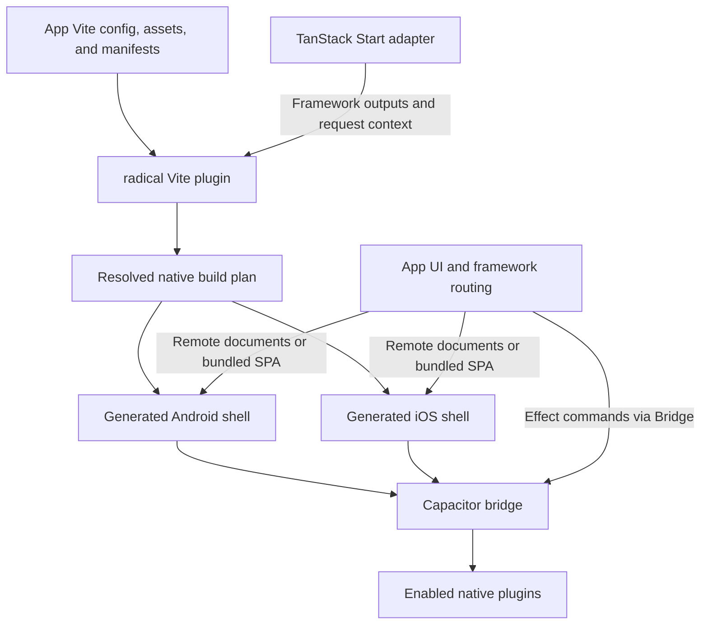
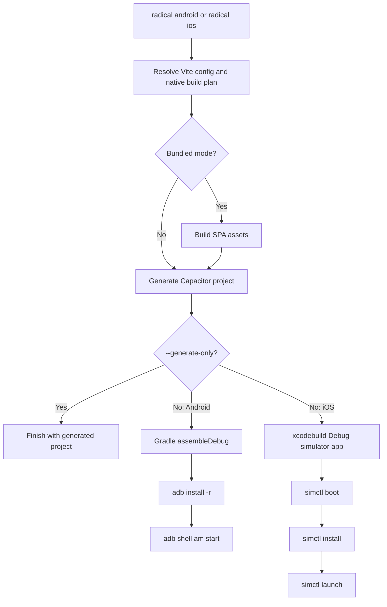

Native projects are generated output. Keeping identity, assets, manifests, and source files outside `.radical` makes regeneration repeatable.

## App, framework adapter, and generated shells

Radical owns loading, context, safe area, offline recovery, and transition overlays. Capacitor supplies the transport and plugin ABI.

The framework keeps rendering, routing, and data fetching.

## One plan drives generation and launch

### Native CLI pipeline

Generation checks dependency versions and copies enabled native sources. Conflicting contributions fail rather than depending on plugin order.

Bundled assets come from the adapter's client output; remote metadata records the UI origin and navigation allowlist.

## Generated files have source inputs

<Tree>
  <Tree.Folder name=".radical" defaultOpen>
    <Tree.File name="native.json" />
    <Tree.File name="plugins.d.ts" />
    <Tree.Folder name="android" defaultOpen>
      <Tree.File name="capacitor.config.json" />
      <Tree.Folder name="android" />
    </Tree.Folder>
    <Tree.Folder name="ios" defaultOpen>
      <Tree.File name="capacitor.config.json" />
      <Tree.Folder name="ios" />
    </Tree.Folder>
  </Tree.Folder>
</Tree>

This tree shows selected outputs, not every generated file. `sharp` writes launcher resources and iOS asset catalogs from source images. The splash remains until the initial document or fallback finishes loading.

<Callout type="warning" title="Regeneration replaces output">

Keep lasting changes in config, source assets, a plugin manifest, or Radical's generator. Manual native-project edits can disappear.

</Callout>

[Run on a device](/docs/guides/run-on-a-device) and [Set app assets](/docs/guides/app-assets) contain the procedures.
