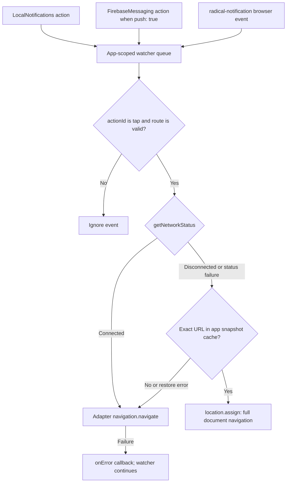

<Steps>
<Step>

## Mount the watcher

In the root component's mount effect, use `useRouter()` and the [example imports](https://github.com/akshat-OwO/radical/blob/main/apps/example/src/routes/__root.tsx):

```tsx
import { watchNotificationNavigation } from "@akshatowo/radical/tanstack-start-client";
import { useRadicalRuntime } from "@akshatowo/radical/react";

const runtime = useRadicalRuntime();
useEffect(() => {
  const stop = watchNotificationNavigation(
    router,
    { appId: config.appId, push: true },
    runtime
  );
  return () => {
    void stop();
  };
}, [router, runtime]);
```

Keep the watcher mounted across screen changes.

</Step>
<Step>

### Set destinations

Use app-relative routes:

| Source | Field | Watcher option |
| --- | --- | --- |
| Local | `route` | Omit `push: true` if local-only |
| Push | `data.route` | `push: true` |
| Offline | Mark route offline; visit exact URL after worker activation | Match query strings |

</Step>
<Step>

### Verify taps

Test invalid routes, online taps, and offline taps to visited URLs.

You see valid destinations open; invalid routes are ignored.

</Step>
</Steps>

### Validated taps select a stored document or router navigation


