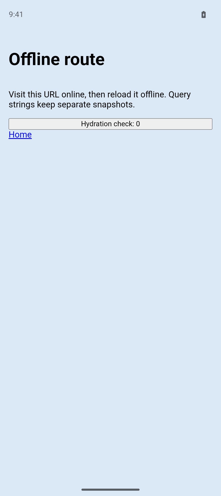
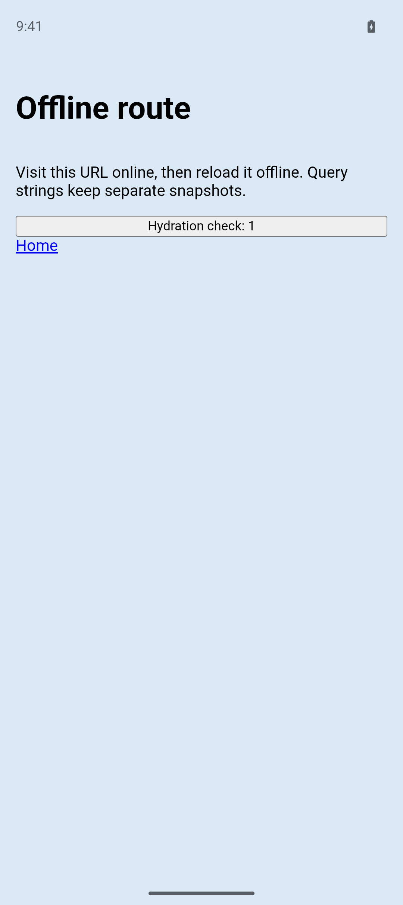
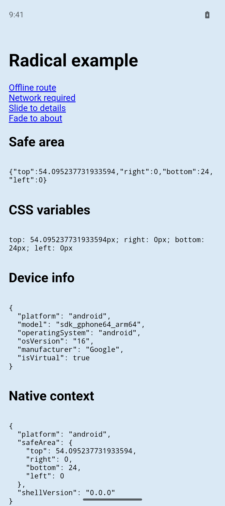
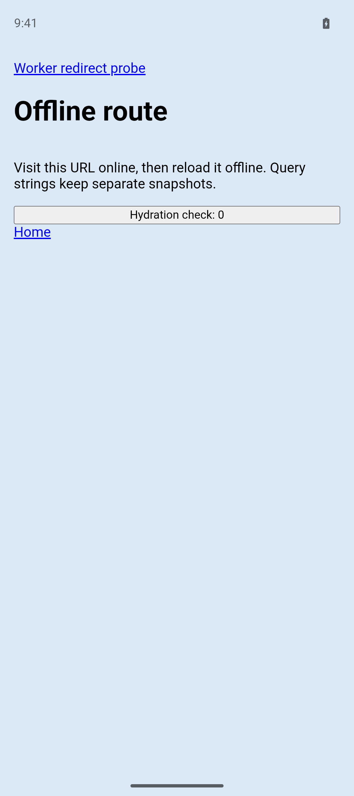
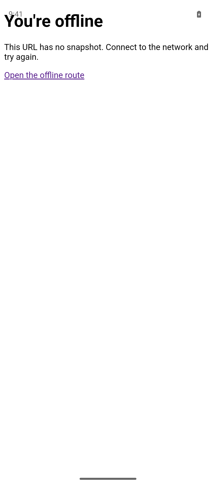
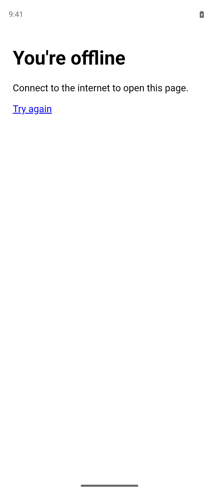

# Android offline routes verification

Reverified on 2026-10-20 for PR #35 revision 1 using only the booted Pixel_9, Android 16, serial `emulator-5554`, Chromium WebView 155, and `dev.radical.example`. The existing agent-device session drove the UI and captured screenshots. WebView CDP inspection checked worker state, Cache Storage, and native bridge calls. No other emulator or simulator was started.

## Setup

Built radical and the production example with `pnpm --filter radical run build` and `pnpm --filter @radical/example run build`. The example uses `devHost: "localhost"`; `.radical/native.json` points at `http://localhost:4173`. Forwarded that port with `adb -s emulator-5554 reverse tcp:4173 tcp:4173` and ran `pnpm --filter @radical/example exec vp preview --port 4173 --host 0.0.0.0`.

Built, installed, and launched the generated shell with Java 21:

```sh
pnpm --filter @radical/example exec radical android --target emulator-5554
```

The CLI completed and stopped Gradle. A fresh registration reported a secure context, one activated worker at `/radical-sw.js`, no waiting worker, and build-versioned asset and snapshot caches. The exact snapshot key was `http://localhost:4173/offline-route`.

## Cold-start investigation and fix

Checked the installed Capacitor 8.5.3 sources. `BridgeWebViewClient.shouldInterceptRequest` delegates to `WebViewLocalServer`. Its `handleProxyRequest` uses `HttpURLConnection` for HTML only when `jsInjector` is non-null. `Bridge.loadWebView` installs the bridge with `addDocumentStartJavaScript` and clears `jsInjector` when that feature succeeds. Therefore, the proposed HTML-proxy explanation is a real path in Capacitor, but it did not explain this device's remaining failure: returning `null` for allowed main frames alone still reproduced it. Radical now explicitly bypasses that proxy for remote main frames and uses document-start bridge injection.

Instrumented the native request callbacks in a disposable generated project. With an activated registration, no waiting update, and the exact snapshot still present after restart, the first native app navigation failed with `ERROR_CONNECT`, code -6. No worker network callback occurred for that navigation. The next worker callback was for the packaged error page, whose document acquired the controller. A later renderer navigation to the same snapshot URL succeeded offline. Removing startup network blocking or replacing the load/cancel/reload sequence with one native load did not change that result.

The missing step was establishing the origin's worker client before the app navigation. Startup now serves a packaged page at `/.radical/launch`, completes `navigator.serviceWorker.getRegistration(target)`, and then navigates with `location.replace(target)`. The app navigation consequently goes through the restored worker. This gate uses an API completion, without timers, network probes, an extra worker, or a user retry. Its absence-of-worker path still launches the target. Disposable tracing and diagnostic worker changes were removed before final verification.

## Offline cold launch and bridge

Visited **Offline route** online after worker activation. Stopped preview and disabled both interfaces:

```sh
adb -s emulator-5554 shell svc wifi disable
adb -s emulator-5554 shell svc data disable
adb -s emulator-5554 shell am force-stop dev.radical.example
adb -s emulator-5554 shell am start -W -n dev.radical.example/.MainActivity
```

The cold launch landed directly at `/offline-route` with an active controller and its snapshot, without a fallback or retry. The counter hydrated and incremented while the server remained stopped.





On that worker-served page, `Capacitor.nativePromise("Device", "getInfo", {})` resolved with platform `android`, model `sdk_gphone64_arm64`, and OS version `16`. This verifies that document-start injection supplies a working native bridge on snapshots.

## Online launch and offline URL selection

The shell asks Android ConnectivityManager for an active network with `NET_CAPABILITY_INTERNET`. Online starts select the configured server URL. Offline starts select `lastOfflineUrl`, defaulting to the server URL if no snapshot has been recorded. The generated manifest grants `ACCESS_NETWORK_STATE`.

The saved URL comes from completed Cache Storage snapshots, which the shared worker writes only after the framework marks eligible HTML with `x-radical-offline: 1`. The page checks its exact URL in this app's snapshot caches and sends an origin-restricted main-frame web message. Native code verifies that the reported URL is still the current page. Initial worker activation notifies the page after capture completes. Unit tests cover that ordering, exact query keys, other apps' caches, assets, unavailable storage, and stale documents.

After visiting `/offline-route`, visited `/online-route`. Native preferences still contained only `lastOfflineUrl=http://localhost:4173/offline-route`. With the interfaces restored and preview running, force-stopped and relaunched. It opened the configured `/`, not either previous route.



## Navigation policy and worker redirects

The allowlist is a top-level navigation policy. Ordinary subresources and worker fetches may cross origins and follow redirects. The optional worker client only serves packaged startup and fallback pages. Missing `SERVICE_WORKER_SHOULD_INTERCEPT_REQUEST` no longer calls `finish()`.

Used a temporary diagnostic worker response at `/__worker-redirect` that returned `Response.redirect("http://127.0.0.1:4175/destination", 302)`. A local destination fixture recorded requests and would send `/executed` if its page script ran. Tapped a visible link to that worker-handled navigation through agent-device. The shell stayed on `/offline-route`, native logs reported:

```text
RadicalNavigation: Blocked http://127.0.0.1:4175/destination
```

The fixture received no `/destination` or `/executed` request, and `window.redirectProbeRan` remained false. The existing `shouldOverrideUrlLoading`, `onPageStarted`, and document-start guard remain in place. The unit guard tests also cover a disallowed top-level document and permitted subframes.



Separately issued a no-CORS fetch from the worker to `http://localhost:4175/redirect`, which redirected to `http://127.0.0.1:4175/resource`. The fixture received both `/redirect` and `/resource`. JavaScript received the expected opaque response. This confirms that the revision permits ordinary cross-origin worker fetches and redirects. The diagnostic worker response and fixture were not committed.

## Fallback and clear storage

The worker still serves the app's cached `public/offline.html` for URLs without a snapshot.



After storing and reopening a snapshot, ran `adb -s emulator-5554 shell pm clear dev.radical.example`. It returned `Success`, and the app-private data directory was empty before relaunch. With preview stopped and the interfaces disabled, relaunch showed the packaged fallback. Inspection returned:

```json
{
  "controller": null,
  "caches": [],
  "registrations": 0
}
```



WebView stores snapshots and registrations in app-private storage. Android Clear storage also removes cookies and offline URL preferences. The startup and fallback pages ship in the APK and survive. No native clear API or `clearWebData` hook was added.

## Checks and cleanup

`pnpm exec ultracite fix`, `pnpm exec ultracite check`, `pnpm install --frozen-lockfile`, and `pnpm run ready` passed, including all 113 tests. The generated Android debug build passed. In-memory launch tests verify that navigation waits for registration lookup and proceeds when the worker API is absent.

Stopped dev, preview, the diagnostic destination server, and Gradle. Restored Wi-Fi and mobile data, removed the temporary adb forwards, and left Pixel_9 booted.
