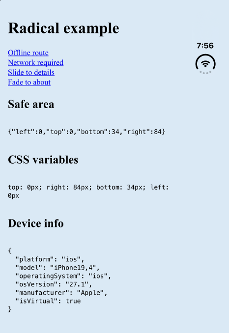
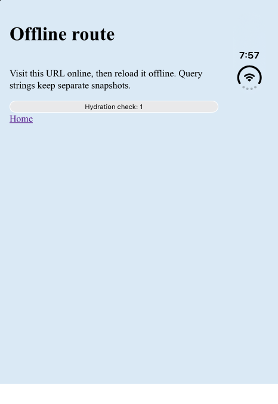
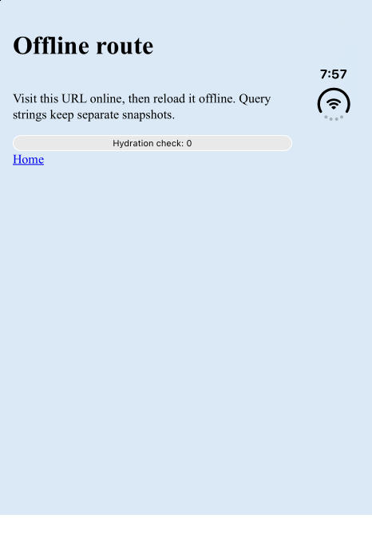
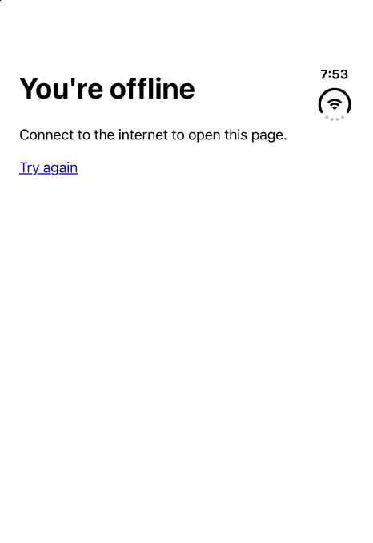
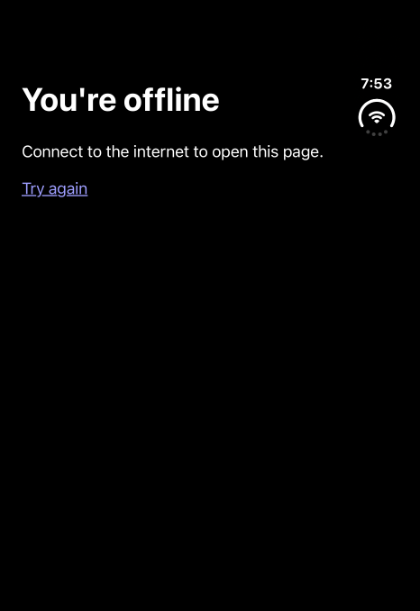

# iOS offline routes verification

Verified on 2026-10-20 with Xcode 27.1, iPhone Duo, iOS 27.1, UDID `88BEE7A3-757E-40C4-A789-5E3259B6B673`, and `dev.radical.example`. Only this already-booted simulator was used. The T3 Device panel and agent-device drove the app and captured the screenshots. No physical device was available.

## Reproduce the setup

Build the package and production example:

```sh
pnpm --filter radical run build
pnpm --filter @radical/example run build
pnpm --filter @radical/example exec vp preview --port 4173 --host 127.0.0.1
```

The example uses `devHost: "localhost"`. Its generated `.radical/native.json` points at `http://localhost:4173`. The iOS simulator shares the host network; it needs no port forwarding. Localhost is a trustworthy origin for service workers even over HTTP. Plain HTTP LAN addresses are not. Physical-device remote mode needs HTTPS.

Build, install, and launch on the existing simulator:

```sh
pnpm --filter @radical/example exec radical ios --target 88BEE7A3-757E-40C4-A789-5E3259B6B673
```

The CLI uses xcodebuild and simctl and does not require Simulator.app. The generated Info.plist contains `WKAppBoundDomains = [localhost]`. Capacitor's configuration sets `ios.limitsNavigationsToAppBoundDomains = true`, and the controller uses `WKWebsiteDataStore.default()`. Diagnostic evaluation confirmed `isSecureContext: true`, a worker at `http://localhost:4173/radical-sw.js`, and one active registration scoped to `/`.

Visit **Offline route** while preview is running. Wait for worker activation and snapshot capture before testing offline. The native saved URL becomes `http://localhost:4173/offline-route`. Visiting an online-only route, including **About**, leaves that preference unchanged.

## Online launch and offline navigation

An online process restart opens the configured `/`, even after a snapshot has been saved.



Return to the home page, stop preview with Ctrl-C, then follow **Offline route**. Confirm the server is unavailable:

```sh
curl --max-time 2 -I http://localhost:4173
```

The connection refused on this run. The route reopened from its snapshot. Its React counter incremented with the server stopped.



## Cold launch restores the worker without a startup gate

Keep preview stopped, terminate the app, and reopen it:

```sh
xcrun simctl terminate 88BEE7A3-757E-40C4-A789-5E3259B6B673 dev.radical.example
xcrun simctl launch 88BEE7A3-757E-40C4-A789-5E3259B6B673 dev.radical.example
```

The app opens `/offline-route`, without a WebView error page or a user retry.



Inspected Capacitor's `CAPBridgeViewController.loadWebView` and `webViewConfiguration`. The navigation calls `WKWebView.load(URLRequest)` directly. The configuration applies the App-Bound Domains flag before constructing the WebView. There is no remote HTTPS document proxy on this path.

Added disposable logging and JS evaluation only to the ignored generated project to examine the cold launch. The first main-frame response was the worker's cached fallback for `/`, with `x-radical-offline-fallback: 1`. The proxy cancelled that response and tried the saved snapshot. WebKit reported policy interruption code 102 for the cancelled navigation, which the proxy correctly ignored. The next response carried `x-radical-offline: 1` for `/offline-route`.

This establishes that WebKit restored the worker before the first cold navigation response. The Android first-navigation worker bypass did not reproduce, so iOS has no packaged startup gate, registration wait page, or connectivity probe. Startup remains network-first. On either a native load failure or a marked worker fallback, it tries the saved snapshot once.

Diagnostic evaluation on the offline snapshot returned:

```json
{
  "href": "http://localhost:4173/offline-route",
  "origin": "http://localhost:4173",
  "secure": true,
  "controller": "http://localhost:4173/radical-sw.js",
  "registrations": [
    {
      "scope": "http://localhost:4173/",
      "active": "http://localhost:4173/radical-sw.js"
    }
  ],
  "snapshotKeys": ["http://localhost:4173/offline-route"]
}
```

The cache name was `radical:dev.radical.example:/:<build-id>:snapshots`. Calling `Capacitor.nativePromise("Device", "getInfo", {})` on this offline page returned platform `ios`, model `iPhone19,4`, and OS version `27.1`. The hydrated counter also worked. Regenerated and rebuilt the shell to remove all diagnostic code before capturing the final screenshots and repeating navigation and cold launch.

## Clearing storage and first offline launch

After demonstrating snapshot recovery, stopped the server and uninstalled and reinstalled the app:

```sh
xcrun simctl uninstall 88BEE7A3-757E-40C4-A789-5E3259B6B673 dev.radical.example
xcrun simctl install 88BEE7A3-757E-40C4-A789-5E3259B6B673 apps/example/.radical/ios/build/Build/Products/Debug-iphonesimulator/App.app
xcrun simctl launch 88BEE7A3-757E-40C4-A789-5E3259B6B673 dev.radical.example
```

The old app data was removed. The new app had no worker registration or snapshot caches. Its first network navigation failed with `NSURLErrorDomain` code `-1004`, connection refused, and the native delegate loaded the packaged fallback. Diagnostic evaluation returned:

```json
{
  "href": "http://localhost:4173/",
  "origin": "http://localhost:4173",
  "secure": true,
  "registrations": [],
  "snapshots": []
}
```



The fallback uses `loadHTMLString(_:baseURL:)` with the failed allowed URL as its base. WebKit keeps the allowed origin, so the existing navigation proxy and App-Bound Domains remain in force. `WKURLSchemeHandler` cannot serve HTTPS, and no custom-scheme proxy was added. The packaged document uses `color-scheme: light dark`, `Canvas`, `CanvasText`, and `LinkText`. Its **Try again** link recovered to the live home page when preview restarted.



Snapshots and registrations live in the persistent website data store. Uninstall and reinstall clears them and the saved URL preference. [ADR 0002](../adr/0002-ios-offline-caching-with-app-bound-domains.md) separately verified `WKWebsiteDataStore.removeData` with all website data types. Website-data removal alone can leave the URL preference, but cannot restore deleted content. No native command for verification or public `clearWebData` hook ships; the hook remains #24.

## Navigation policy and limits

The proxy still enforces exact origins, including scheme and port, for top-level actions and main-frame responses. App-Bound Domains do not replace it. Subframes, ordinary cross-origin subresources, and worker fetches are not filtered by that policy.

In-memory generation tests accept ten distinct app-bound hostnames and reject an eleventh with `InvalidConfig` before spawning Capacitor or replacing the prior project. Ports share one hostname entry while retaining separate exact-origin navigation entries. Three worker origins remain the observed ceiling from the spike; this implementation uses one stable worker URL and build-versioned caches.

## Checks and cleanup

Passed:

- `pnpm exec ultracite fix`
- `pnpm exec ultracite check`
- `pnpm install --frozen-lockfile`
- `pnpm run ready`, including 21 test files and 115 tests
- The generated iOS Debug build on iPhone Duo

The lockfile has no `@pnpm/exe` entries. Tests cover both shells' offline eligibility, exact snapshot URL reporting, first-activation notification, stale documents, unavailable storage, worker fallback markers, and iOS domain/config generation using in-memory layers.

Stopped all preview servers started for this task, restored light appearance, and left iPhone Duo booted. Physical devices, earlier iOS versions, and storage eviction remain unverified.
