# Native snapshot transitions verification

Verified on 2026-10-20 on Pixel_9, Android 16, API 36, serial `emulator-5554`, and iPhone Duo, iOS 27.1, UDID `88BEE7A3-757E-40C4-A789-5E3259B6B673`. The user supplied one booted device at a time. Android verification preceded the iOS re-verification at `0e4634b`. The iOS round found no runtime defect and updates only verification evidence. Android stayed shut down during that round.

## Android setup

Built radical, started the example at localhost port 4173, forwarded the port, and generated the shell:

```sh
pnpm --filter radical run build
pnpm --filter @radical/example exec vp dev --host 0.0.0.0 --port 4173
adb -s emulator-5554 reverse tcp:4173 tcp:4173
pnpm --filter @radical/example exec radical android --generate-only
cd apps/example/.radical/android/android
JAVA_HOME=/Library/Java/JavaVirtualMachines/zulu-21.jdk/Contents/Home ./gradlew assembleDebug testDebugUnitTest --no-daemon
```

The generated Debug build and unit tests passed. Installed the APK and drove the app through `/Users/akshat/.t3/userdata/device/bin/agent-device`, always with the supplied Android serial, host config, and session flags. No emulator or simulator was started by the agent.

## Android motion and capture

Recorded with `adb -s emulator-5554 shell screenrecord --time-limit 90 /sdcard/radical-push-final.mp4`, then pulled the recording to `/tmp/radical-push-final.mp4`. These stills come from that recording.

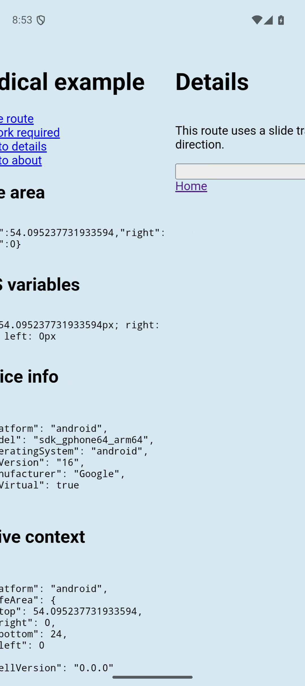

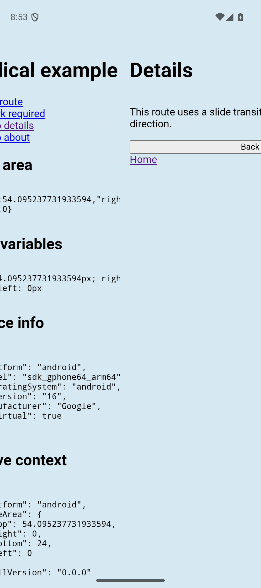

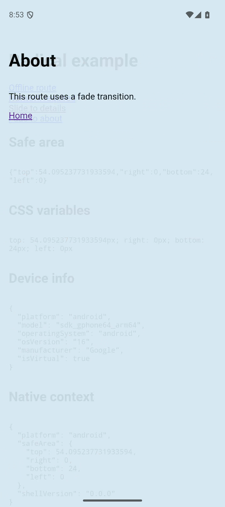

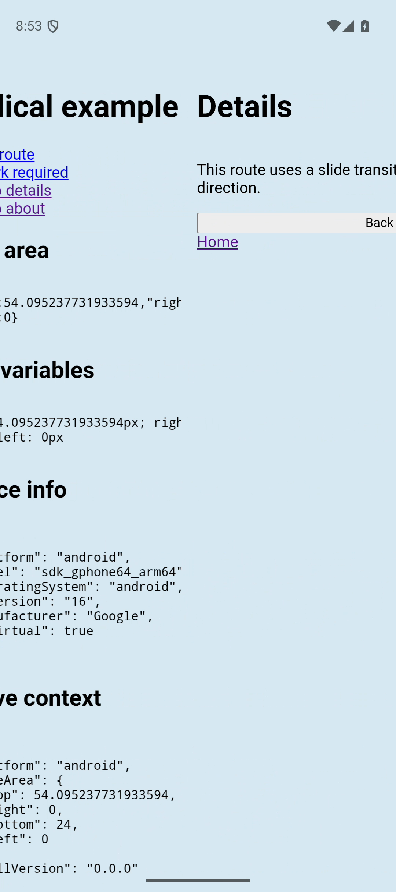

PixelCopy captured the outgoing WebView text, links, safe-area values, and device information. Those details remain visible in the moving Home snapshot after the live WebView contains Details. The capture is neither blank nor a stale copy of another route.

Forward reveal moves the live content branch from one window width to zero over the old snapshot. The snapshot shifts left by 30% of the width. Back keeps the snapshot in front and moves it right while the destination returns from a -30% offset. Native logs record `kind: "slide", direction: "back"` for both system Back and the edge gesture. Both returned from Details to Home without leaving the activity. The generated shell now owns an OnBackPressedDispatcher callback because the optional Capacitor App plugin is absent.

Reviewed every encoded frame in the intervals 7.70 to 8.40 seconds for forward slide, 8.50 to 9.20 for system Back, 15.90 to 16.80 for fade, and 32.70 to 33.60 for gesture Back. The review includes the old screen, capture, layer ordering, motion, and cleanup. No white, black, or empty frame appeared. Background content stayed continuous under the status and navigation bars. Android screenrecord uses variable frame timing; this checks the recorded frames, not unrecorded sub-frame behavior.

## Forced reveal timeout

In the Debug WebView's DevTools session, temporarily wrapped `Capacitor.nativePromise` so the first `RadicalTransitions.reveal` call returned a promise that never settled. Other commands used the real native bridge. No source, native plugin, or app file was modified for this probe.

Tapped Slide to details with agent-device. The live DOM heading became Details while the native Home snapshot still covered it. The bridge probe recorded cover at 87870.5 ms, stalled reveal at 87913.5 ms, and remove at 88898.7 ms on the page's performance clock. The combined paint-and-reveal timeout caused removal roughly one second after capture, before the native three-second watchdog. The route remained `/details` and its heading remained Details.

Recorded this run with `adb shell screenrecord --time-limit 20 /sdcard/radical-timeout.mp4` and pulled it to `/tmp/radical-timeout.mp4`. The source frame at 1.3653 seconds displays the old Home snapshot until 2.302456 seconds; the next frame shows the committed Details route. These stills use source frame indices 3 and 4, so variable frame timing cannot cause a seek to choose the wrong side of removal.

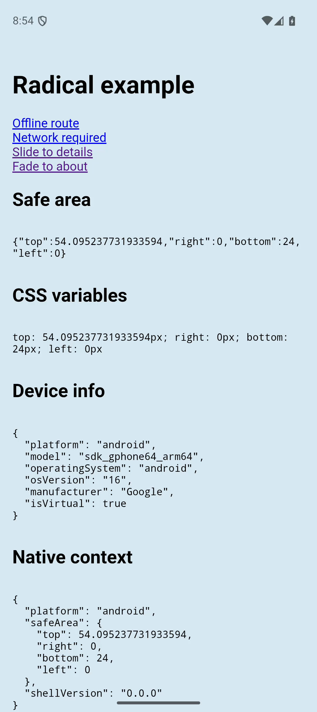

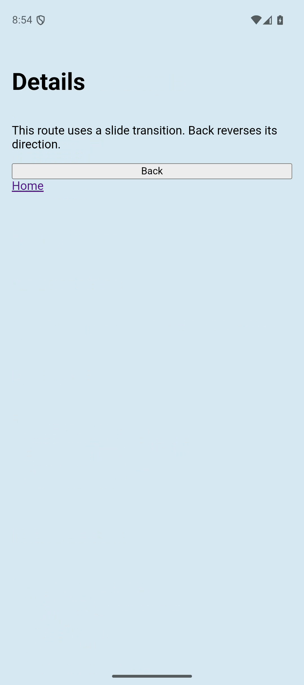

Restored the original bridge method after the probe. Native process-death watchdog recovery was not exercised. The native watchdog, pending PixelCopy cancellation, and id guards were inspected in source.

## Ordering and failure tests

`native-transitions.test.ts` uses in-memory Layers, `it.effect`, and TestClock. It verifies capture before commit, paint before reveal, plain commit after capture failure or timeout, navigation error preservation, stalled reveal and cleanup recovery, interruption cleanup, malformed acknowledgements, and shell strategy selection without browser support. A deferred commit remains pending across a five-second TestClock advance with `timeoutMs: 100`; it then resolves with its original result and removes the overlay. The commit itself has no transition timeout.

`tanstack-navigation.test.ts` exercises actual Router commits for slide, fade, reversed history back, transition opt-out, and restoration of the original hook. Its insecure-origin regression removes `crypto.randomUUID` for the test scope, restores the original descriptor on every exit, and verifies initial, unmarked, opted-out, and native route commits. Consecutive native overlay ids show that plain commits do not consume counter values.

Each shell acknowledges cover only after attachment. Android attaches only after PixelCopy succeeds and checks the id again in its callback. JavaScript waits for the framework commit and two animation frames before reveal. Android then waits for Chromium's visual-state callback; iOS waits for a WebKit snapshot of the committed content. Offset setup and layer reordering happen in one native callback before the next presented frame. Cleanup cancels motion and resets live content to zero before removing the snapshot.

## iOS re-verification at 0e4634b

Built radical, started the example at localhost port 4173, and generated, built, installed, and launched the clean head shell:

```sh
pnpm --filter radical run build
pnpm --filter @radical/example exec vp dev --host 0.0.0.0 --port 4173
pnpm --filter @radical/example exec radical ios --target 88BEE7A3-757E-40C4-A789-5E3259B6B673
```

All interactions used the supplied agent-device executable, iOS UDID, host config, and session flags. Recorded with `xcrun simctl io 88BEE7A3-757E-40C4-A789-5E3259B6B673 recordVideo --codec=h264`. Normal motion recordings are `/tmp/radical-ios-push-0e4634b.mov` and `/tmp/radical-ios-fade-0e4634b.mov`. These replace the earlier outgoing-only slide evidence.

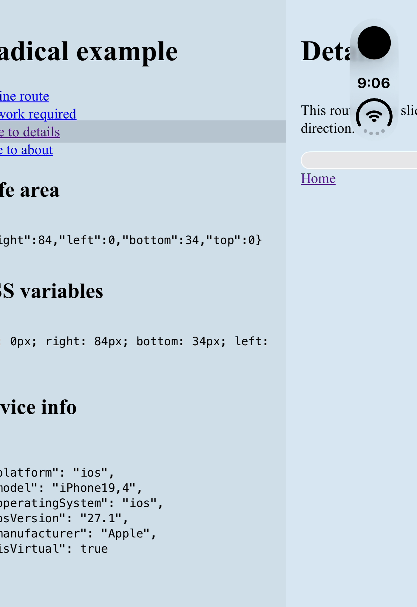

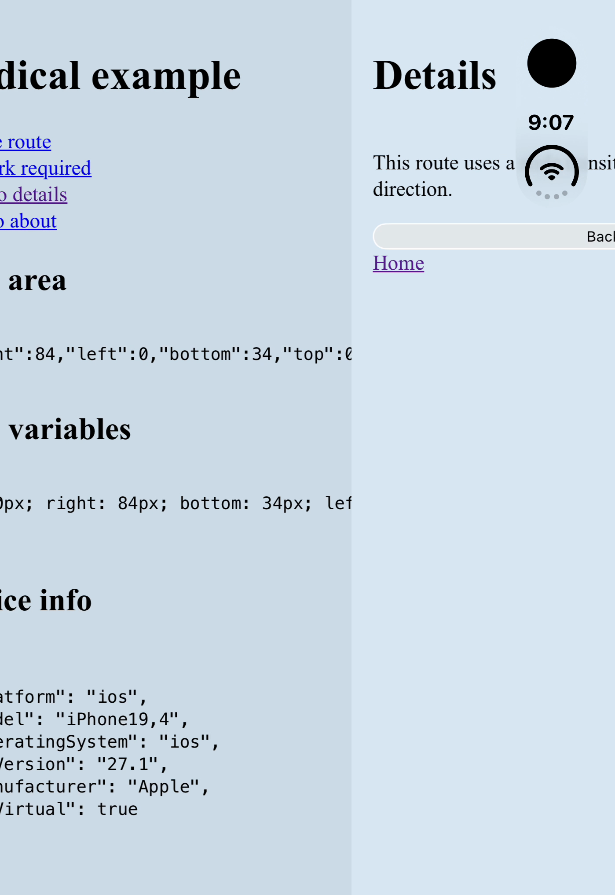

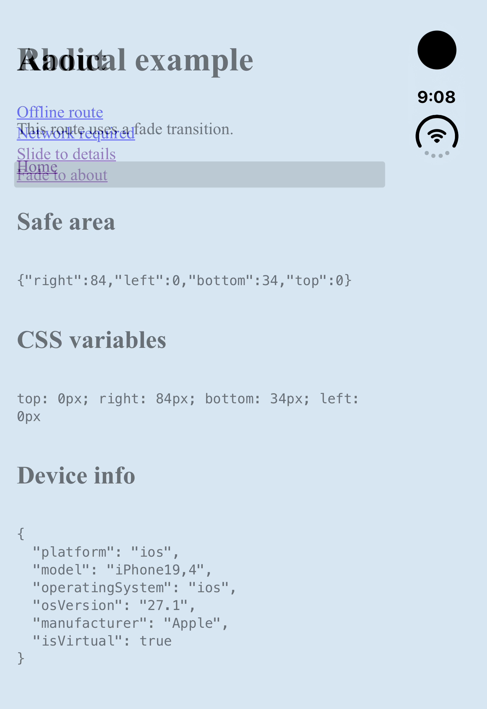

Forward slide moves Details in from the right while Home shifts left by the configured 30% parallax and darkens. The mid-slide still shows a dimmed Home background beside the brighter incoming page. Button Back moves Details out to the right while Home returns from its negative parallax offset and undims. Fade smoothly replaces Home with About. All destinations settled with the live content at its normal position.

Reviewed every encoded frame from 8.60 to 9.30 seconds for forward slide and 24.30 to 25.20 for Back in the push recording, plus 10.55 to 11.10 in the fade recording. These windows include capture, initial offsets and stacking, motion, and final cleanup. No blank, white, or black frame appeared. The old and new pages meet without an exposed window background, including the right-side system area. Recordings have variable frame timing; the review covers encoded frames rather than unrecorded sub-frame behavior.

### iOS forced reveal timeout

For this probe only, added a document-end user script and trace logging to the ignored generated AppDelegate.swift. The script wraps `Capacitor.nativePromise` and returns a never-settling promise for the first `RadicalTransitions.reveal`; cover and remove still call the real native plugin. The library and native transition implementation remain the head versions. Launched the probe with `simctl launch --console-pty` to capture its trace at `/tmp/radical-ios-probe-console.log`.

The trace shows cover at 18589 ms, attachment acknowledgement at 18597 ms with the Home heading, stalled reveal at 18616 ms after the heading became Details, remove at 19603 ms, and removal acknowledgement at 19605 ms. Native logging reports `overlayAttached=false` after removal. Cleanup completed about one second after capture, before the three-second native watchdog. The route and heading remained Details.

Recorded `/tmp/radical-ios-timeout-0e4634b-final.mov`. Source frame 11 at 10.750000 seconds shows the Home snapshot held over the already-committed destination; source frame 12 at 11.673333 seconds shows Details after removal. Extracted those exact source indices to avoid seeking across a held frame. Reviewed every encoded frame between 10.50 and 12.00 seconds, including both sides of removal. No blank frame appeared.

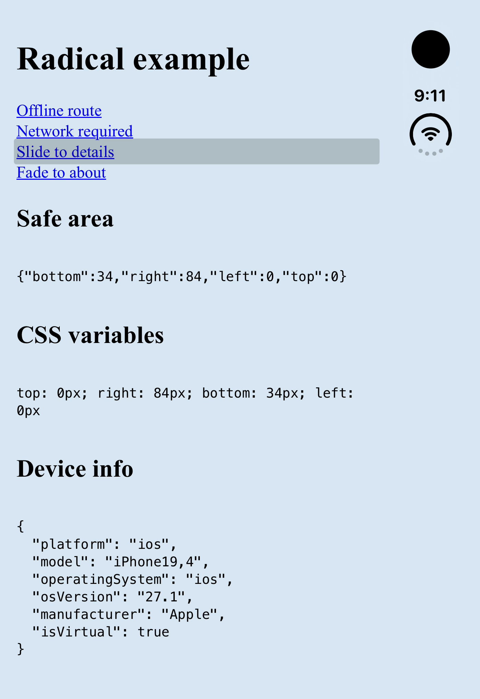

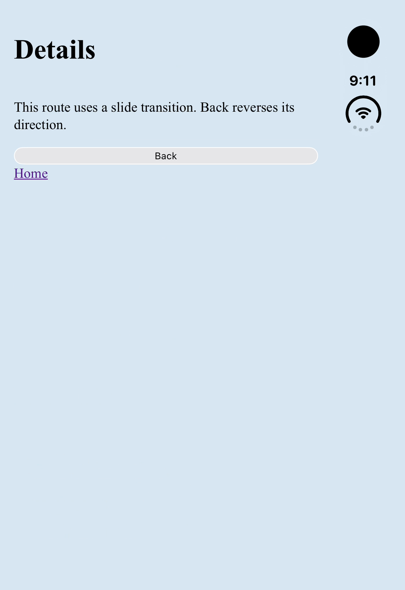

### iOS swipe-back is disabled

The probe logs `swipeEnabled=false canGoBack=true` on the live WKWebView after the Details history entry exists. In the clean shell, an agent-device `gesture swipe left-edge` on Details leaves the route and screen unchanged; button Back then returns to Home. Repeated the edge swipe after removing the probe and reinstalling the clean head shell, with the same result. No competing WebKit history swipe was enabled.

Regenerated the shell to remove all probe code, rebuilt, installed, and launched the clean version again. Confirmed no `RADICAL_VERIFY` code remains in the generated AppDelegate.swift. Repeated slide, disabled edge swipe, and button Back on that clean installation. Review items 1 and 4 now have iOS device verification. Native process-death watchdog recovery remains unexercised.

## Repository checks and cleanup

`pnpm exec ultracite fix`, `pnpm exec ultracite check`, `pnpm run ready`, and `pnpm install --frozen-lockfile` pass. Ready includes 127 passing tests. The lockfile is unchanged and contains no `@pnpm/exe` entry. The example server and Gradle are stopped after verification. Pixel_9 is shut down. The clean iOS shell is installed and iPhone Duo remains booted.
