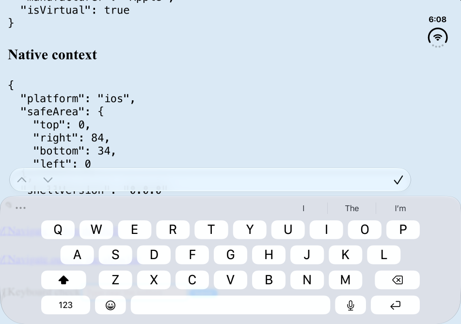
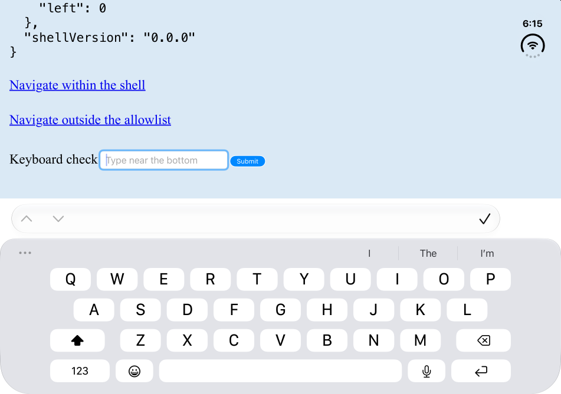
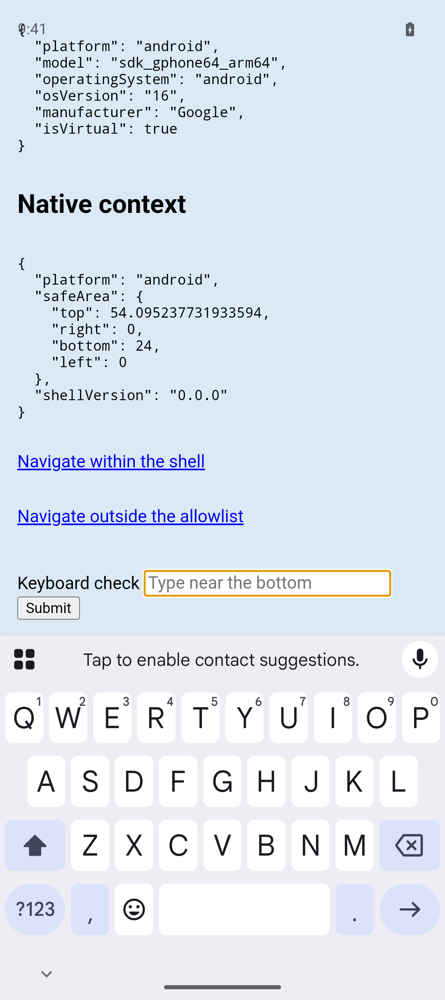

# Safe-area revision verification

Verified on 2026-10-20 with Pixel_9, Android 16, and iPhone Duo, iOS 27.1, in the T3 Code Device panel.

## iOS keyboard

The failure reproduces on the Duo inner display, 951 × 669 points. With `contentInsetAdjustmentBehavior = .never`, WebKit leaves the focused bottom field behind the keyboard. The cover display, 466 × 678 points, scrolls the same field correctly with either inset behavior. Testing only the cover display misses the regression.

Changing the inset behavior to `.automatic` lets UIKit account for the keyboard and scroll the focused field above it on both displays. The WebView remains the controller's full-window root view. The hook, cookie, and CSS values remain `top: 0, right: 84, bottom: 34, left: 0` on the inner display. The keyboard height does not enter the safe-area cookie.

The PR base already uses Capacitor's default `.never`. This PR adds `viewport-fit=cover` and a bottom form, exposing the failure on the inner display. The regression is not evidence that the PR changed Capacitor's default inset behavior.





The fold tool returns `CoreDevice reported no hinge angle sample: Unknown option '--device'` after sending the hinge event. The screenshot dimensions confirm that the app moved from the cover to the inner display; the hinge angle itself remains unverified.

## Android keyboard

The viewport shrinks from 924 to 588 CSS pixels. The focused input ends at 550.87 and Submit ends at 572.30, both above the keyboard. The hook and CSS bottom inset become zero during input and return to 24 after dismissal. The body background extends under the system bars, and the WebView starts at window coordinate zero. Neither platform logged a hydration warning on the fresh CLI runs. Rebuilding the library while the Android keyboard inset changes can still produce a development HMR hydration warning; clean launches after restarting the dev server passed.



## Client bundle

Build each revision's library with `vp pack`, then build its example with `vp build`. Count every `.js` file under `apps/example/dist/client`, including the worker, and sum each file's `gzipSync` length using Node 24.16.0 with default gzip settings. These are decimal bytes, not KiB. Dependencies are held to the existing lockfile.

- PR base `cc6c057`: 439,525 bytes raw; 141,785 bytes gzip.
- Previous PR head `17279c5`: 449,838 raw; 145,396 gzip. Safe-area delta: 10,313 raw; 3,611 gzip.
- This revision: 443,111 raw; 143,184 gzip. Safe-area delta: 3,586 raw; 1,399 gzip.

The earlier 4.79 kB gzip comparison used local main `73942f8`, before the typed bridge and device-info hook landed. It included unrelated bridge work. The correct base is the PR's `cc6c057`.

A controlled build that keeps the old generic hook but isolates style constants from runtime schemas and replaces DOM event decoding measures 443,869 raw and 143,448 gzip. That removes 1,948 gzip bytes. Simplifying the React subscription removes another 264 gzip bytes. Total reduction is 2,212 gzip bytes, or 61.3% of the safe-area delta.

`vp build --minify=false` identifies the retained code. Runtime imports of `native-context.ts` construct context schemas, and `Schema.decodeUnknownEffect` on every event keeps schema failure formatting and related helpers. The old scoped subscription also retains Effect scope/finalizer code. The revised output drops 23,354 bytes of unminified Effect code, including 16,466 from the Effect implementation and public wrappers, 3,535 from Formatter, and 1,953 from Order.

The remaining gzip delta is 993 bytes in the main chunk, including the hook, provider context, style helper, browser probe, and root-document wiring; 396 bytes in the example route chunk for safe-area diagnostics and the keyboard form; and 10 bytes across the remaining chunks from changed import hashes. Server cookie validation still uses Schema. The DOM event boundary uses finite, nonnegative number checks; the exported Effect watcher still supports scoped callers. Shell scripts own CSS updates.

## CLI launch

Both full commands build, install, launch, and exit successfully:

```sh
pnpm exec radical android --target emulator-5554
pnpm exec radical ios --target 88BEE7A3-757E-40C4-A789-5E3259B6B673
```

Android's `native-run@2.0.3` invokes `adb shell am start -W` with a hardcoded 5,000 ms timeout. Its timeout handler kills and restarts the shared adb server. The server restart and retried command have no second deadline, so that retry sequence can remain pending. A measured cold launch took 5,292 ms and returned `Status: ok`, exceeding that timeout even though the launch succeeded.

The Android runner now calls Gradle, adb install, and adb activity launch directly. It stops Gradle after the build and waits up to 30 seconds for activity launch without restarting adb. A stalled launch returns Effect's typed `TimeoutError`. The iOS runner uses `simctl launch`, also with a 30-second typed timeout. Successful iOS CLI runs returned the app PID and exited; no iOS launch hang reproduced.

In-memory runner tests verify command order, failed-build cleanup, authorized-device selection, and stalled launch timeouts with TestClock. No test uses real devices, timers, or network.
