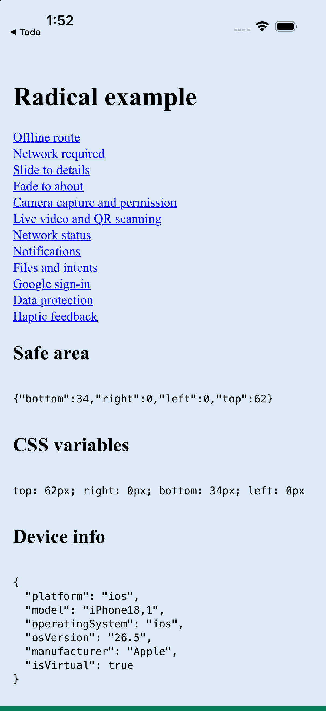
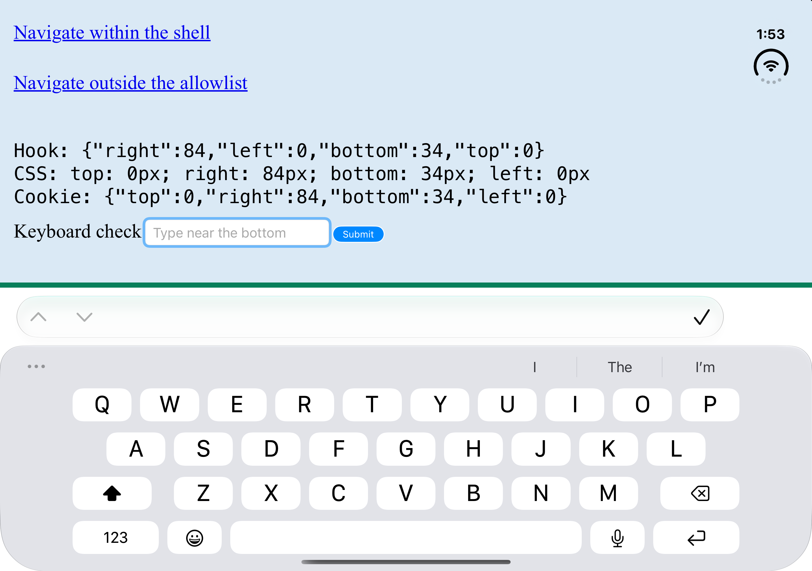
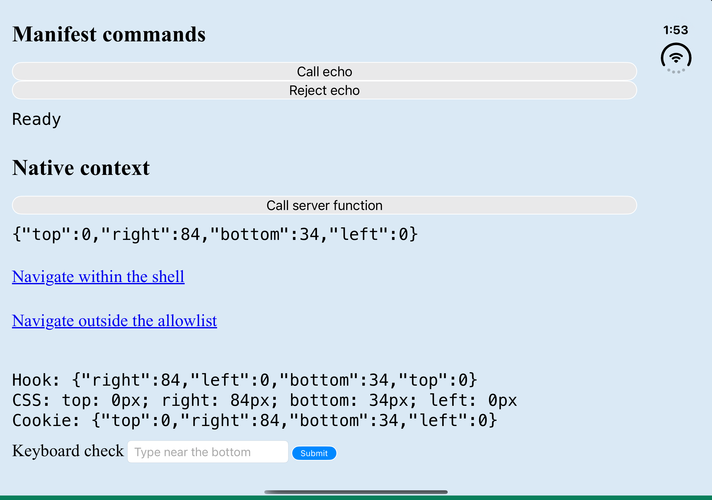
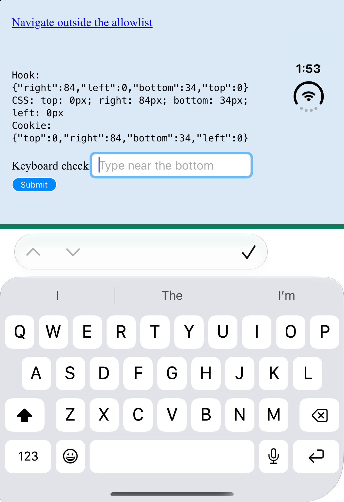
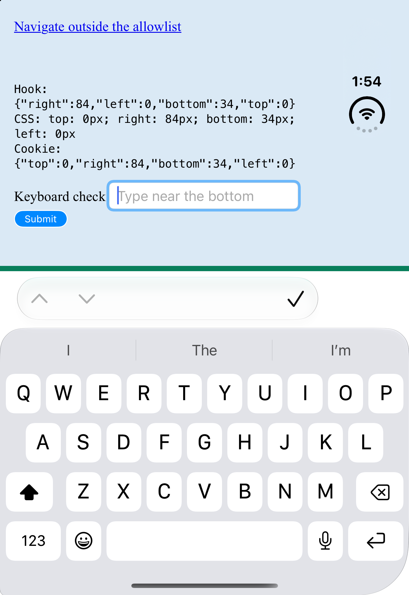

# Safe-area revision verification

## iOS keyboard and screen edges

Verified on 2026-10-24 using the remote-mode example at `http://localhost:4173`, the booted iPhone 17 Pro on iOS 26.5, and iPhone Duo on iOS 27.1. Both shells built, installed, and launched through the CLI:

```sh
pnpm --filter @akshatowo/radical exec vp pack
pnpm --filter @radical/example exec vp dev --host localhost --port 4173
# Run the CLI from apps/example in another terminal.
pnpm exec radical ios --target F69D9CE5-20E1-4388-9EBA-27B1782EEF75
pnpm exec radical ios --target 88BEE7A3-757E-40C4-A789-5E3259B6B673
```

The shipped approach uses scroll insets. The controller preserves Capacitor's default `.never`, observes keyboard will-change-frame and will-hide, converts screen coordinates into view coordinates, and applies the covered height to the bottom content and vertical indicator insets. Hide resets both to zero. Observers are removed on deinitialization. WebKit revealed the field and Submit on the inner display with these insets, so the frame-resize fallback was unnecessary. Safe-area reporting still reads only `view.safeAreaInsets`.

For verification, the example temporarily added a 6 px green `position: fixed; bottom: 0` marker and repeated its hook, CSS, and server cookie diagnostics immediately above the existing bottom form. Focusing the field requested the server context after one second, while the keyboard was visible. Those temporary page edits were restored after capture. The non-white page background is the example's existing `#dae9f5`.

- **Pass:** iPhone 17 Pro has no white strip under the home indicator. The fixed green marker reaches the bottom screen edge.
- **Pass:** Duo inner display, 951 × 669 points, reveals both the focused field and Submit above the keyboard.
- **Pass:** Duo cover portrait, 466 × 678 points, reveals the focused field and Submit above the keyboard.
- **Not run:** Duo cover landscape. Both `orientation landscape-left` and `orientation landscape-right` reported success, but display 1 remained 1398 × 2034 pixels with the portrait keyboard. The attempted-rotation capture below is evidence of this limitation, not a landscape pass.
- **Pass:** dismissing the inner-display keyboard restores the full page without a bottom gap.
- **Pass:** inner-display hook, CSS, and the server's cookie-derived context remain `top: 0, right: 84, bottom: 34, left: 0` while the keyboard is open and after dismissal.

The devices were opened in the T3 Device panel and driven with agent-device. Fold commands sent the hinge event but returned `CoreDevice reported no hinge angle sample: Unknown option '--device'`. Panel changes were confirmed from the active screenshot and its dimensions; hinge angles remain unverified. Capture Duo cover with `xcrun simctl io <UDID> screenshot --display=1 <path>` and inner with `--display=3`. The default display can be black on the inactive panel.











The earlier `.automatic` fix restored keyboard scrolling but also added UIKit's bottom safe-area inset on top of CSS padding. The explicit keyboard insets replace that setting. The historical regression capture remains available as [the field hidden with no keyboard handling](safe-area/ios-keyboard-before.png).

## Android keyboard

The viewport shrinks from 924 to 588 CSS pixels. The focused input ends at 550.87 and Submit ends at 572.30, both above the keyboard. The hook and CSS bottom inset become zero during input and return to 24 after dismissal. The body background extends under the system bars, and the WebView starts at window coordinate zero. Neither platform logged a hydration warning on the fresh CLI runs. Rebuilding the library while the Android keyboard inset changes can still produce a development HMR hydration warning; clean launches after restarting the dev server passed.


## Client bundle

Build each revision's library with `vp pack`, then build its example with `vp build`. Count every `.js` file under `apps/example/dist/client`, including the worker, and sum each file's `gzipSync` length using Node 24.16.0 with default gzip settings. These are decimal bytes, not KiB. Dependencies are held to the existing lockfile.

- PR base `cc6c057`: 439,525 bytes raw; 141,785 bytes gzip.
- Previous PR head `17279c5`: 449,838 raw; 145,396 gzip. Safe-area delta: 10,313 raw; 3,611 gzip.
- This revision: 443,111 raw; 143,184 gzip. Safe-area delta: 3,586 raw; 1,399 gzip.

The earlier 4.79 kB gzip comparison used local main `73942f8`, before the typed bridge and device-info hook landed. It included unrelated bridge work. The correct base is the PR's `cc6c057`.

A controlled build that keeps the old generic hook but isolates style constants from runtime schemas and replaces DOM event decoding measures 443,869 raw and 143,448 gzip. That removes 1,948 gzip bytes. Simplifying the React subscription removes another 264 gzip bytes. Total reduction is 2,212 gzip bytes, or 61.3% of the safe-area delta.

`vp build --minify=false` identifies the retained code. Runtime imports of `native-context.ts` construct context schemas, and `Schema.decodeUnknownEffect` on every event keeps schema failure formatting and related helpers. The old scoped subscription also retains Effect scope/finalizer code. The revised output drops 23,354 bytes of unminified Effect code, including 16,466 from the Effect implementation and public wrappers, 3,535 from Formatter, and 1,953 from Order.

The remaining gzip delta is 993 bytes in the main chunk, including the hook, provider context, style helper, browser probe, and root-document wiring; 396 bytes in the example route chunk for safe-area diagnostics and the keyboard form; and 10 bytes across the remaining chunks from changed import hashes. Server cookie validation still uses Schema. The DOM event boundary uses finite, nonnegative number checks; the exported Effect watcher still supports scoped callers. Shell scripts own CSS updates.

## CLI launch

Both full commands build, install, launch, and exit successfully:

```sh
pnpm exec radical android --target emulator-5554
pnpm exec radical ios --target 88BEE7A3-757E-40C4-A789-5E3259B6B673
```

Android's `native-run@2.0.3` invokes `adb shell am start -W` with a hardcoded 5,000 ms timeout. Its timeout handler kills and restarts the shared adb server. The server restart and retried command have no second deadline, so that retry sequence can remain pending. A measured cold launch took 5,292 ms and returned `Status: ok`, exceeding that timeout even though the launch succeeded.

The Android runner now calls Gradle, adb install, and adb activity launch directly. It stops Gradle after the build and waits up to 30 seconds for activity launch without restarting adb. A stalled launch returns Effect's typed `TimeoutError`. The iOS runner uses `simctl launch`, also with a 30-second typed timeout. Successful iOS CLI runs returned the app PID and exited; no iOS launch hang reproduced.

In-memory runner tests verify command order, failed-build cleanup, authorized-device selection, and stalled launch timeouts with TestClock. No test uses real devices, timers, or network.
