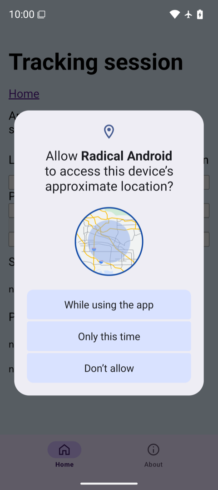
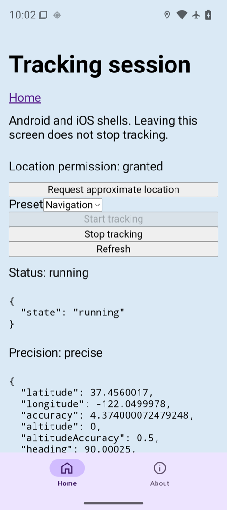
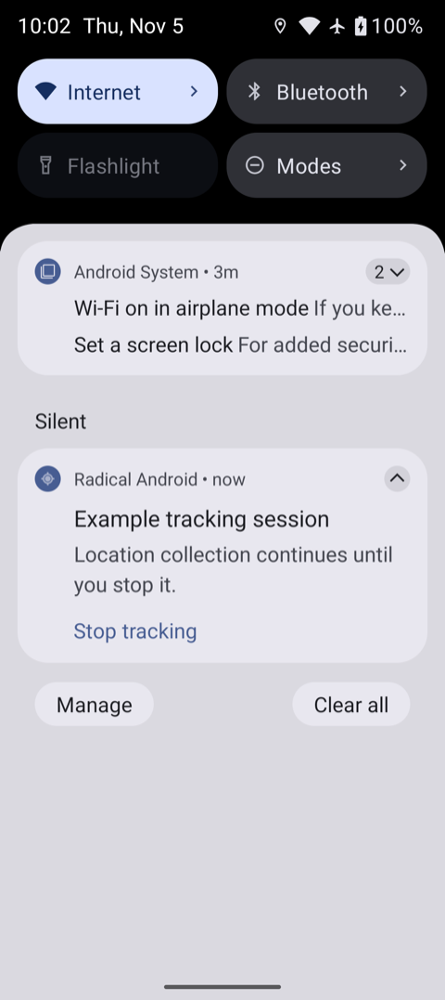
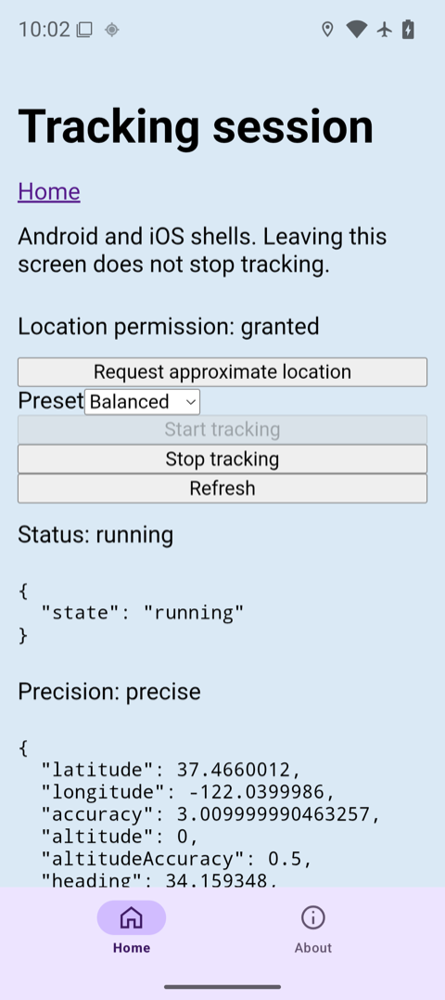
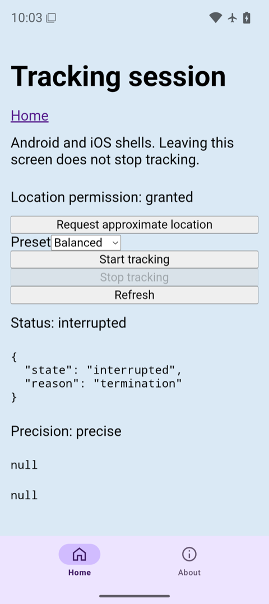
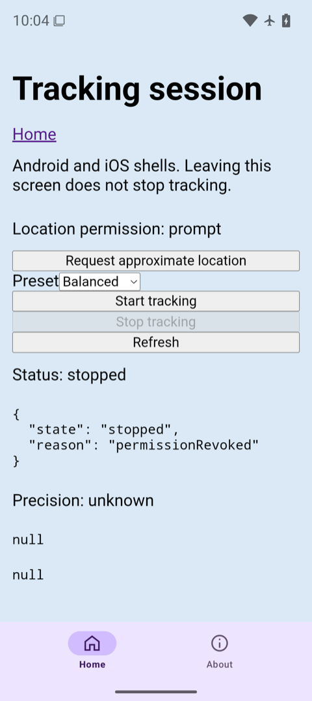
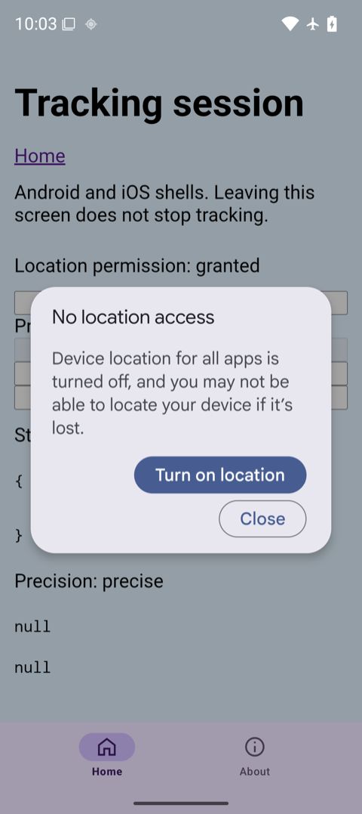
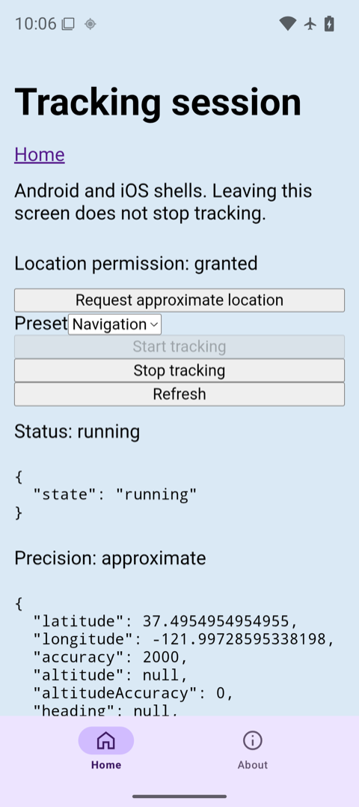
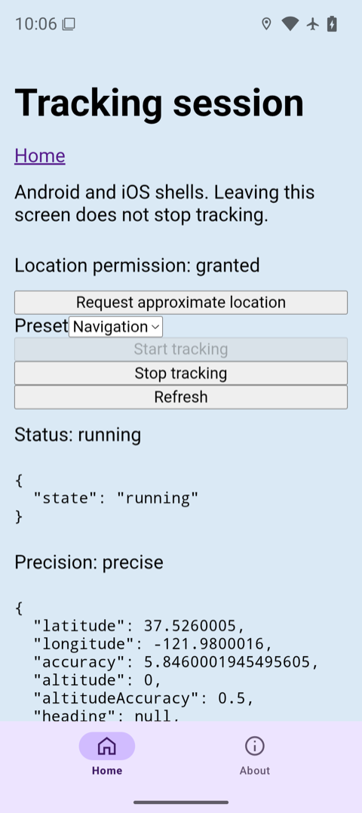

# Android tracking session verification

Verified on 2026-11-08 for [#176](https://github.com/akshat-OwO/radical/issues/176), against main commit `c5869625e1cf3b437d1a8797efdb596b41307a0f`. All ten checks passed. No radical bugs were found, and no bug issues were filed.

Device: Pixel_9 Android 16 emulator, API 36, serial `emulator-5554`, arm64. App: `dev.radical.example.android`, version 1.2.3, build 127. Chromium WebView: 155.0.8059.43. Build tools: Java 21, Gradle 8.14.3, Node 26.13.0, pnpm 12.14.0, Vite+ 1.4.0, Capacitor 8.5.3.

This is emulator verification, not physical-device verification. Real preset update rates, battery use, GPS accuracy, and long-duration background limits were deliberately excluded, as agreed in the issue.

## Setup and evidence

Read ADR 0022, the tracking guide, the example Tracking route and config, and the existing Android offline verification record. Rebuilt both packages and regenerated the Android project with tracking enabled:

```sh
pnpm --filter radical run build
pnpm --filter @radical/example run build
pnpm --filter @radical/example exec vp preview --port 4173 --host 0.0.0.0
adb -s emulator-5554 reverse tcp:4173 tcp:4173
JAVA_HOME=/Library/Java/JavaVirtualMachines/zulu-21.jdk/Contents/Home pnpm --filter @radical/example exec radical android --target emulator-5554
```

The native build reported `BUILD SUCCESSFUL in 30s`, `489 actionable tasks: 489 executed`, install `Success`, and cold launch `Status: ok`. The earlier attempt's APK was not used as build evidence.

T3 `device_open`, host `local`, device `Pixel_9`, supplied the pinned agent-device command. That command drove app launches, taps, the notification shade, sleep and wake, and screenshots. T3 `device_screenshot` inspected the permission prompt. Port 4174 and iOS were untouched.

For diagnostics, forwarded port 9223 to the current process's `webview_devtools_remote_<pid>` socket. Read snapshots with `Capacitor.nativePromise("RadicalTrackingSession", "getTrackingSession", {})`. The example displays status, precision, and latest-fix JSON. The [full native snapshots](tracking-android/sessions.json) also retain ids, revisions, and notification state. [Selected logcat lines](tracking-android/logcat.txt) corroborate delivery and typed errors. The emulator's wall clock was November 5, while the host date was November 8. Device timestamps and logcat dates are preserved without correction.

The agent-device CDP helper failed with `error: unknown option '--serial'`. A temporary direct WebView CDP client performed diagnostic reads, the WebView reload, and the two API guard probes that the example's disabled Start button cannot invoke. No product code changed.

## 0. Native build and manifest: pass

Inspected `apps/example/.radical/android/android/app/build/intermediates/merged_manifests/debug/processDebugManifest/AndroidManifest.xml`. It included:

```xml
<uses-permission android:name="android.permission.FOREGROUND_SERVICE" />
<uses-permission android:name="android.permission.FOREGROUND_SERVICE_LOCATION" />
```

Inside `<application>`, the service declaration named `dev.radical.example.android.RadicalTrackingService` and set `android:foregroundServiceType="location"`. There was no `ACCESS_BACKGROUND_LOCATION` declaration. The generated service compiled, and the APK installed and launched.

## 1. Explicit start and moving fixes: pass

Opened **Tracking session**, tapped **Request approximate location**, and accepted **While using the app**. The prompt requested approximate location only. Selected **Navigation** and tapped **Start tracking**. Snapshot `01-start-denied` records the first running session with approximate permission.



Granted precise location for the moving-route and lifecycle checks, then explicitly stopped and started a new Navigation session. Fed a route with repeated commands, including:

```sh
adb -s emulator-5554 emu geo fix -122.084 37.422
adb -s emulator-5554 emu geo fix -122.080 37.426
adb -s emulator-5554 emu geo fix -122.070 37.436
adb -s emulator-5554 emu geo fix -122.060 37.446
adb -s emulator-5554 emu geo fix -122.050 37.456
```

Snapshots `02-route-a`, `03-locked`, and `04-other-app` show session `ff1126eb-32bf-4aad-bbbf-96bcbae0d505` advancing through revisions 13, 20, and 31. Coordinates progressed from approximately `37.422, -122.084` to `37.436, -122.070` and `37.446, -122.060`. On return, the example displayed the next route point, approximately `37.456, -122.050`.



## 2. Locked screen, another app, and notification Stop: pass

Sent agent-device `hardware-button sleep`, injected locations, and inspected the native session while the display remained asleep. `dumpsys power` reported `mWakefulness=Asleep`. Revision 20 contained the new `37.436, -122.070` fix. Woke the screen, opened Android Settings, injected another point, and read revision 31 while Settings was in front. Returning to Radical showed further delivery.

Granted `POST_NOTIFICATIONS` for the notification check. Opened the notification shade and expanded **Example tracking session**. It showed the configured body and **Stop tracking** action.



Tapped that notification action. The notification disappeared, and snapshot `05-notification-stop` reported `{"state":"stopped","reason":"user"}` for the same session.

## 3. WebView reload: pass

Started another session, acquired a fix, and called `location.reload()` through WebView CDP. Snapshots `06-before-reload` and `07-after-reload` retained id `61601fb3-a87d-422e-9192-11fa2987672b`, the Navigation options, and a non-null latest fix. Revisions advanced from 59 to 69 as native acquisition continued. The reloaded example displayed `running` and the current fix near `37.466, -122.040`.



An agent-device exact-text wait timed out because its current snapshot collapsed the WebView text. The screenshot, native JSON, and subsequent accessibility snapshot confirmed the loaded state. This was an automation assertion failure, not a tracking failure.

## 4. Force-stop and next launch: pass

During that running session:

```sh
adb -s emulator-5554 shell am force-stop dev.radical.example.android
```

Relaunched through agent-device and reopened Tracking. Snapshot `08-force-stop` retained the session id, reported `{"state":"interrupted","reason":"termination"}`, and had `latest: null`. The screen enabled Start and disabled Stop. Tracking resumed only after an explicit Start tap.



## 5. Permission revocation, including process death: pass

During session `82384b85-a54b-4eab-a940-c7ac535ea981`, revoked both location grants:

```sh
adb -s emulator-5554 shell pm revoke dev.radical.example.android android.permission.ACCESS_FINE_LOCATION
adb -s emulator-5554 shell pm revoke dev.radical.example.android android.permission.ACCESS_COARSE_LOCATION
```

`pidof` returned no process after revocation. Relaunched through agent-device. Snapshot `11-revoked` reported `stopped: permissionRevoked`, denied permission, and `latest: null`. Granted coarse permission again and tapped Refresh. Snapshot `12-regranted` is the same terminal record as `11-revoked`: same id, revision 1, and still `permission.state: denied`, because a stopped session's permission is not refreshed. It shows that the grant and Refresh did not restart tracking; it is not evidence that the grant was in effect. The grant appears in `13-approximate`, where a later explicit Start created a new session with approximate permission.



## 6. Location services off and on: pass

Before revoking permission, toggled services during session `82384b85-a54b-4eab-a940-c7ac535ea981`:

```sh
adb -s emulator-5554 shell cmd location set-location-enabled false
adb -s emulator-5554 shell cmd location set-location-enabled true
```

Snapshot `09-services-off` reported `suspended: servicesOff`, revision 3. Snapshot `10-services-on` reported `running`, revision 4, with the same id. No new Start action was needed.



## 7. Approximate-only tracking: pass

With coarse permission granted and fine permission revoked, explicitly started a Navigation session. Snapshot `13-approximate` reports id `0473d3d6-e76e-4436-b77b-349ee14cd00a`, `running`, `precision: approximate`, and a fix at `37.4954954954955, -121.99728595338198`, accuracy 2,000 m, revision 7. The example displayed that fix and approximate precision.

The emulator initially supplied no network-provider location and did not activate GPS for the coarse-only request. To provide a GPS source, opened Google Maps with a one-time precise grant, then continued `emu geo fix` injections. Radical received the coarsened fix while Maps was in front. This verifies coarse delivery and reporting when a source fix exists. It does not establish standalone coarse acquisition latency. A temporary mock network provider had been tried without producing a radical fix and was removed before this successful check.



## 8. Notification permission denied: pass

Revoked `POST_NOTIFICATIONS`, relaunched, and explicitly started a Navigation session with precise location granted. Fed more route points. Snapshot `16-notifications-denied` reports `running`, `notifications.state: denied`, and a non-null fix near `37.526, -121.980`, revision 7. `dumpsys package` confirmed notifications denied and both location permissions granted. Tracking remained controllable through the example's Stop button.



## 9. Active-session and foreground guards: pass

Called the native start method through diagnostic CDP because the example disables its Start button during an active session. Snapshot `14-second-start` returned `TrackingSessionAlreadyActive` with the existing id `e313fe55-40cc-4198-866b-364ab63fa77e`. That probe is not in the logcat excerpt. The excerpt's `TrackingSessionAlreadyActive` line at 22:01:14 is an earlier rejection of the same kind, during the first session `c139482e-33f5-4849-8c92-c95e2c1861a2` from `01-start-denied`.

Stopped tracking, opened Android Settings, and confirmed Settings in the accessibility snapshot before invoking start again through the background WebView. Snapshot `15-background-start` returned `TrackingStartRequiresForeground`, message `Activity must be visible`. The background-start rejection appears in the selected logcat evidence. An earlier probe immediately after Home raced the activity transition and started before the app had stopped. It was stopped explicitly, and the settled Settings probe verified the background guard.

## Validation and cleanup

`pnpm exec ultracite fix`, `pnpm exec ultracite check`, and `vp run ready` passed before pushing this record. Ready completed all 16 tasks, including type checks, 944 radical tests across 101 files, and 14 markdown tests.

Stopped tracking, preview, and the agent-device session. `./gradlew --stop` reported no running Gradle daemons. Restored location services, Wi-Fi, and mobile data to on, removed the temporary mock network provider, and restored the shell's mock-location app-op to its default denied mode. Force-stopped Maps, ending its one-time location grant. Uninstalled the example app. Removed adb reverse port 4173 and the diagnostic forward on 9223.

Called T3 `device_close` with `shutdown: true`. Afterwards `adb devices` listed no emulator, and no Pixel_9 qemu or associated scrcpy process remained. Port 4173 had no listener. Deleted the generated Android project, web and library build output, and temporary diagnostic files after preserving this record. No task-owned server, emulator, forward, or temporary file was retained.
