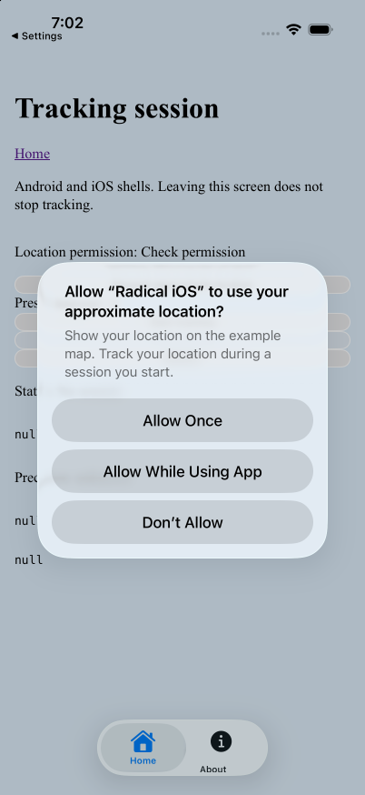
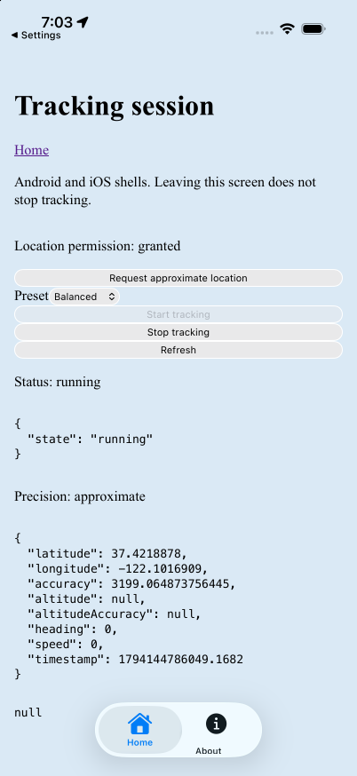
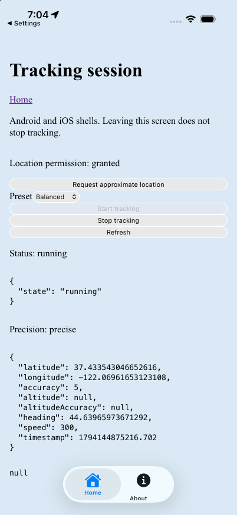
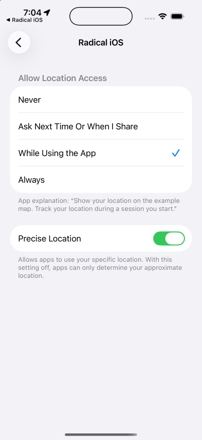
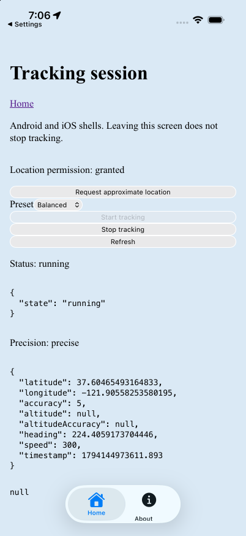
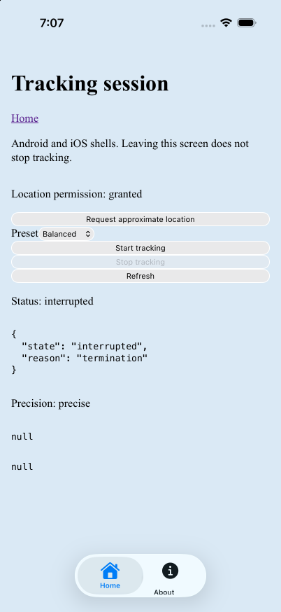
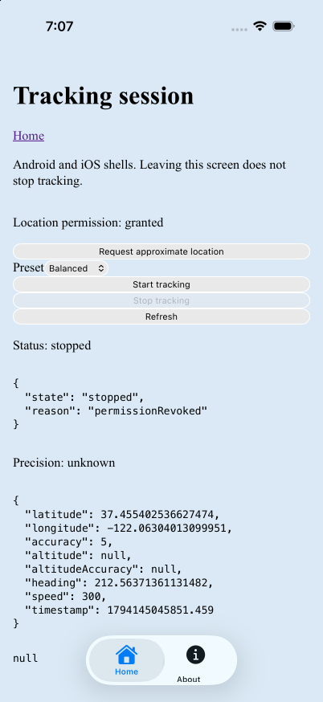
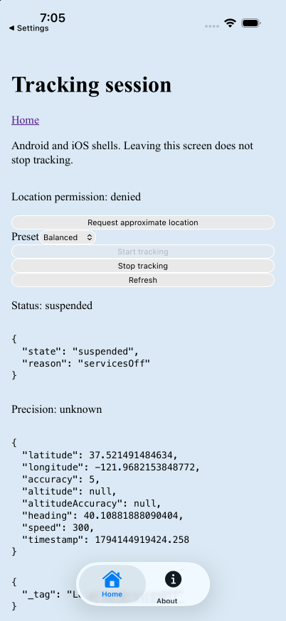
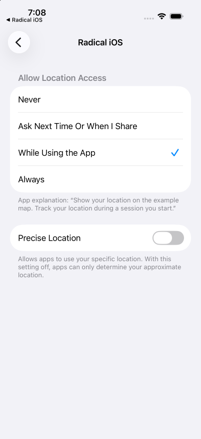
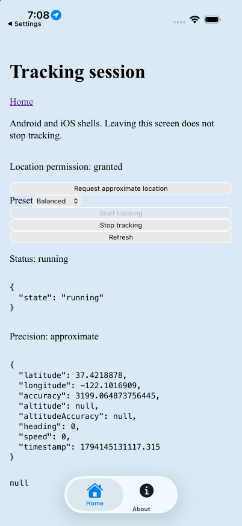

# iOS tracking session verification

Verified on 2026-11-08 for [#176](https://github.com/akshat-OwO/radical/issues/176), with main commit `64a2b92` merged into `t3/verify-ios-tracking`. Checks 0, 1, 3–7, and 9 pass. Check 2 passes for another app in front but remains blocked for screen locking by the required device driver. Check 8 is intentionally skipped. No radical runtime bug was found, and no new issue was filed.

The first run failed to compile because `pluginMethods` inferred `[CAPPluginMethod?]`, recorded in [#198](https://github.com/akshat-OwO/radical/issues/198). Merged [#201](https://github.com/akshat-OwO/radical/pull/201) supplies the explicit `[CAPPluginMethod]` type. This run builds that fix and replaces the blocked runtime record with observed results. No product code or generated Swift was modified for verification.

Device: iPhone 17 Pro simulator, iOS 26.5, UDID `F69D9CE5-20E1-4388-9EBA-27B1782EEF75`. Toolchain: Xcode 27.2 build 27B52, iPhoneSimulator 27.2 SDK, Capacitor 8.5.3, Node.js 26.13.0, pnpm 12.14.0. App: `dev.radical.example.ios`, version 1.2.3, build 127. This is simulator verification. Real preset update rates, battery use, GPS accuracy, and long-duration background limits are deliberately excluded, as agreed in #176. This record does not close #176.

## Setup and evidence

Read issues #176 and #198, PR #199, ADR 0022, the tracking guide and example, the Android tracking record, and the iOS offline setup. Created a local branch from `origin/t3/verify-ios-tracking` and merged `origin/main` without rebasing.

Built radical and the production example, then started preview on the dedicated iOS port:

```sh
pnpm --filter radical run build
RADICAL_ORIGIN=http://localhost:4174 pnpm --filter @radical/example run build
RADICAL_ORIGIN=http://localhost:4174 pnpm --filter @radical/example exec vp preview --port 4174 --host 127.0.0.1
RADICAL_ORIGIN=http://localhost:4174 pnpm --filter @radical/example exec radical ios --generate-only
```

The generated `.radical/native.json` and Capacitor configuration both targeted `http://localhost:4174`. The simulator shares the host network and needs no port forwarding. The example already enables `internalPlugins.trackingSession: true` and `location: true`.

Built and installed without using the CLI's automatic simctl launch:

```sh
xcodebuild -project apps/example/.radical/ios/ios/App/App.xcodeproj \
	-scheme App -configuration Debug -sdk iphonesimulator \
	-destination id=F69D9CE5-20E1-4388-9EBA-27B1782EEF75 \
	-derivedDataPath apps/example/.radical/ios/build build
xcrun simctl install F69D9CE5-20E1-4388-9EBA-27B1782EEF75 \
	apps/example/.radical/ios/build/Build/Products/Debug-iphonesimulator/App.app
```

T3 `device_open` supplied the pinned agent-device command. It drove every launch, tap, Settings change, permission grant, and screenshot. T3 `device_screenshot` inspected the permission prompt, location indicator, and Settings. No other device was used.

A disposable [inspect-webkit](https://github.com/EvanBacon/inspect-webkit) 0.0.5 bridge on loopback port 9224 connected to the simulator's WebKit remote inspector. Diagnostic evaluation called `Capacitor.nativePromise("RadicalTrackingSession", "getTrackingSession", {})`, reloaded the WebView, and probed second start. The [native snapshots](tracking-ios/sessions.json) preserve complete return values and the typed rejection. Promise results were read after resolution, rather than treating the inspector's empty Promise object as a session. [Selected Core Location log lines](tracking-ios/native-log.txt) corroborate native acquisition and background transitions. The bridge and client required no application instrumentation.

## 0. Native build and Info.plist: pass

Xcode exited 0 with `** BUILD SUCCEEDED **`. Installation exited 0, and agent-device launched the generated app. The [build excerpt](tracking-ios/build.txt) retains the command and result.

Re-read the generated Info.plist with `plutil -p` and compared its extracted values with the prior record. The [Info.plist evidence](tracking-ios/info-plist.json) remains unchanged:

- `UIBackgroundModes` contains exactly `location` and `remote-notification`, once each.
- `NSLocationWhenInUseUsageDescription` and `NSLocationAlwaysAndWhenInUseUsageDescription` are present and nonempty.
- `NSLocationDefaultAccuracyReduced` is `true`.

The Always description's presence does not imply an Always request. The observed prompt requested approximate When-In-Use access.

## 1. Explicit start and moving fixes: pass

Opened **Tracking session**, tapped **Request approximate location**, then **Allow While Using App**. The prompt said **use your approximate location**. No Always prompt appeared during this run, including backgrounding, reload, termination, and permission changes. Settings continued to show **While Using the App**.



Tapped **Start tracking** with the default Balanced preset. Snapshot `01-route-a` records session `545160C7-3B2A-4A0E-B0B6-3B460116CD72`, `running`, approximate precision, and a non-null coarsened fix at `37.4218878, -122.1016909`, revision 4.



Fed a moving route with `simctl location start`. Approximate delivery initially retained its coarsened point. Enabled Precise Location in Settings to make movement visible for the lifecycle checks, without changing When-In-Use authorization. Restarted the simulated route:

```sh
xcrun simctl location F69D9CE5-20E1-4388-9EBA-27B1782EEF75 start \
	--speed=300 --interval=1 \
	37.422,-122.084 37.622,-121.884 37.422,-122.084
```

Snapshot `05-route-precise` reports revision 18 and `37.433543046652616, -122.06961653123108`. Snapshot `06-settings-front` advances to revision 29 and `37.455006522873774, -122.04346472238048`. The screen displayed the changing fix.



The simulator briefly reported `LocationTimeout` before source fixes arrived. Tracking stayed running, and subsequent fixes cleared `lastError`. No acquisition-rate or accuracy claim is inferred from this route.

## 2. Another app and locked screen: incomplete

**Other app: PASS.** Opened Settings while the precise moving route continued. Snapshot `06-settings-front` came from the background Radical WebView and advanced from revision 18 to 29 with a new fix. After further Settings navigation, returning to Radical yielded revision 113 in `12-background-return`, still running with the same id and another fix. Reload and the services toggle happened between those samples, so they do not establish uninterrupted delivery throughout that entire period. Revision 29 independently establishes delivery with Settings in front.

The simulator showed a black location arrow beside the clock and a purple arrow beside Radical in Location Services. It did not show a blue background-location pill in the inspected screens.



**Locked screen: BLOCKED.** The required agent-device command returned:

```text
Error (UNSUPPORTED_OPERATION): hardware-button is not supported on this device
Hint: No Apple leaf carries this system button.
```

Its capability list omits `hardware-button`. Settings' Accessibility screen also omitted Touch and AssistiveTouch, so its Lock Screen action was unavailable. The [driver evidence](tracking-ios/lock-driver.txt) retains the refusal and capabilities. No lock was achieved, and no locked-screen fix is claimed. This is a verification-tool limitation, not an observed radical failure. This portion still needs a device driver that supports locking.

## 3. WebView reload: pass

Snapshot `10-before-reload` reports revision 65, the original session id, and a non-null fix. Called `location.reload()` through WebKit remote inspection. Snapshot `11-after-reload` retained the id, Balanced options, and running state, with a newer fix and revision 72. The reloaded Tracking screen showed the current fix.



## 4. Termination and next launch: pass

During the original running session:

```sh
xcrun simctl terminate F69D9CE5-20E1-4388-9EBA-27B1782EEF75 dev.radical.example.ios
```

Relaunched through agent-device and reopened Tracking. Snapshot `13-termination` retained the id and reported `interrupted: termination`, `latest: null`, revision 1. Snapshot `14-no-restart` remained unchanged after navigation back to Tracking while simulated locations continued. Start was enabled and Stop disabled. Only the next explicit Start created another session.



## 5. Permission revocation and later grant: pass

Tapped Start to create session `95518025-E634-40C1-B943-14C091F62516`. Snapshot `15-before-revocation` reports running, precise permission, a latest fix, and revision 5. Revoked location while the app was running:

```sh
xcrun simctl privacy F69D9CE5-20E1-4388-9EBA-27B1782EEF75 revoke location dev.radical.example.ios
```

Snapshot `16-revoked` reports `stopped: permissionRevoked`, denied permission, unknown precision, and revision 6. The process remained available to remote inspection. The latest fix remained readable, with its earlier timestamp.



Granted location again through agent-device `settings permission grant location --app dev.radical.example.ios` and tapped Refresh. Snapshot `17-regranted` reports granted permission and revision 7, but the same id stays `stopped: permissionRevoked`, with the unchanged fix. A later explicit Start was required.

## 6. Location Services off and on: pass

Before termination, switched device-wide Location Services off in Settings and accepted **Turn Off**. Returned to Radical for the state read. Snapshot `08-services-off-return` reports revision 63, `suspended: servicesOff`, and `lastError: LocationServicesOff` for the original session. Its permission reports denied with unknown precision while services are off, but the session correctly remains suspended rather than stopped as revoked.



Turned Location Services on in Settings and returned to Radical. Snapshot `09-services-on` reports running, granted precise permission, a new fix, cleared `lastError`, and revision 65, with the same id. No Start tap was needed.

An inspector request made while the app was backgrounded with services off stalled. Returning to the app restored diagnostic access. The reported assertion uses the explicit foreground read, not an assumption about the stalled request.

## 7. Approximate-only tracking: pass

After the revocation check, explicitly turned Precise Location off in Settings while retaining **While Using the App**. The stopped session stayed stopped after that change. Returned to Tracking and tapped Start.



Snapshot `18-approximate` reports a new id, `90C162DA-7A5E-419F-B1CE-DED6BDB3C360`, running, granted approximate permission, revision 10, and a non-null fix at `37.4218878, -122.1016909`, accuracy `3199.064873756445` m. This verifies delivery and precision reporting with Precise Location off, not real GPS accuracy or coarse acquisition latency.



## 8. Interval throttling: skipped

The example exposes no interval option. No code was modified to add one.

## 9. Second start while active: pass

During the original session, called:

```js
Capacitor.nativePromise("RadicalTrackingSession", "startTrackingSession", {
  preset: "balanced",
});
```

Snapshot `03-second-start` records rejection code `TrackingSessionAlreadyActive`, with `data.id: 545160C7-3B2A-4A0E-B0B6-3B460116CD72`. The active session was not replaced. This diagnostic call is necessary because the example disables Start while active.

## Validation and cleanup

Passed `pnpm exec ultracite fix`, `pnpm exec ultracite check`, and `vp run ready` before pushing. These repository checks supplement the successful native build and observed runtime checks.

Stopped tracking, preview, the simulator log stream, and the WebKit inspector bridge and diagnostic clients. Xcodebuild exited normally. Cleared simulated location, left Location Services on, and uninstalled the example app to remove its changed permissions. No other device settings were changed.

Called T3 `device_close` with `shutdown: true`. `xcrun simctl list devices booted` listed no booted simulator. Process inspection found no remaining `AgentDeviceRunner`, `snapshot-bridge`, diagnostic client, Xcodebuild, or simulator log stream. Ports 4174 and 9224 had no listener. Deleted task-generated native and web build output and disposable diagnostics after preserving the evidence. Restored native metadata to its default port 4173. No task-owned server, device session, forward, temporary file, or cleanup failure remains.
