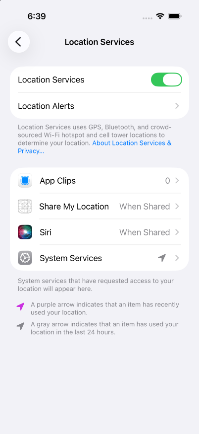

# iOS tracking session verification

Verified on 2026-11-08 for [#176](https://github.com/akshat-OwO/radical/issues/176), at main commit `c5869625e1cf3b437d1a8797efdb596b41307a0f`. Device: iPhone 17 Pro simulator, iOS 26.5, UDID `F69D9CE5-20E1-4388-9EBA-27B1782EEF75`. Toolchain: Xcode 27.2 build 27B52, iPhoneSimulator 27.2 SDK, Capacitor 8.5.3, Node.js 26.13.0, and pnpm 12.14.0. The example declares app version 1.2.3, build 127, bundle id `dev.radical.example.ios`.

The native build failed before installation. This run establishes a compiler failure, not runtime tracking behavior. Filed [#198](https://github.com/akshat-OwO/radical/issues/198). No product code or generated Swift was changed.

## Setup

Read issue #176 and its simulator-scope agreement, ADR 0022, the tracking guide and example, the device guide, and both offline verification records. Opened the specified simulator through the T3 device tools. The returned agent-device command opened Settings and captured the environment screenshot. No other device was used.

Built radical and the production example, then started preview on the dedicated iOS port:

```sh
pnpm --filter radical run build
RADICAL_ORIGIN=http://localhost:4174 pnpm --filter @radical/example run build
RADICAL_ORIGIN=http://localhost:4174 pnpm --filter @radical/example exec vp preview --port 4174 --host 127.0.0.1
```

Both web builds passed. Preview reported `http://127.0.0.1:4174/`. The iOS simulator shares the host network and needs no port forwarding. Port 4173 and the parallel Android verification were left alone.

Generated the native project with the same origin override:

```sh
RADICAL_ORIGIN=http://localhost:4174 pnpm --filter @radical/example exec radical ios --generate-only
```

Generation passed. Both `.radical/native.json` and the generated Capacitor configuration targeted `http://localhost:4174`. An initial generation without the environment override selected the example's default port 4173; it was regenerated before compilation. The example already enables `internalPlugins.trackingSession: true` and `location: true`.

Built the generated project using the build arguments from radical's iOS runner:

```sh
xcodebuild -project apps/example/.radical/ios/ios/App/App.xcodeproj \
	-scheme App -configuration Debug -sdk iphonesimulator \
	-destination id=F69D9CE5-20E1-4388-9EBA-27B1782EEF75 \
	-derivedDataPath apps/example/.radical/ios/build build
```

Used generation plus direct xcodebuild so the CLI's simctl launch would not bypass agent-device. Compilation failed, so installation and app launch were not attempted. A task-owned simulator log stream was started before the build finished, then stopped without collecting tracking evidence.

## Check 0: native build fails, Info.plist passes

Result: **FAIL**. Xcode exited 65 while emitting the app's Swift module. The generated `AppDelegate.swift` includes the tracking template. Its `pluginMethods` declaration infers `[CAPPluginMethod?]`; Capacitor requires `[CAPPluginMethod]`.

Compiler diagnostics, verbatim:

```text
error: type 'RadicalTrackingSessionPlugin' does not conform to protocol 'CAPBridgedPlugin'
note: candidate has non-matching type '[CAPPluginMethod?]'
note: protocol requires property 'pluginMethods' with type '[CAPPluginMethod]'
```

The [compiler excerpt](tracking-ios/build-error.txt) preserves the full diagnostic paths, source lines, protocol requirement, and `BUILD FAILED` summary. The source is `packages/radical/templates/ios/RadicalTrackingSessionPlugin.swift`. [Bug #198](https://github.com/akshat-OwO/radical/issues/198) contains reproduction commands and the excerpt.

The generated Info.plist passed inspection with `plutil -p`. The [extracted values](tracking-ios/info-plist.json) show:

- `UIBackgroundModes` contains exactly `location` and `remote-notification`, once each.
- `NSLocationWhenInUseUsageDescription` and `NSLocationAlwaysAndWhenInUseUsageDescription` are both present and nonempty.
- `NSLocationDefaultAccuracyReduced` is `true`.

Location Services was on in Settings. This screenshot records the environment only; it does not show a running tracking session.



## Runtime checks blocked by #198

No tracking screen, session JSON, session revisions, location fixes, or background indicator could be observed from this build. The following are blocked checks, not observed runtime failures. They need a fresh run after #198 is fixed.

| Check | Result | Evidence and remaining assertion |
| --- | --- | --- |
| 1. Start with approximate When-In-Use permission and a moving route | BLOCKED | Check 0 failed before installation. No permission request, Always-prompt observation, session start, or `simctl location start` run. |
| 2. Updates with screen locked and another app in front | BLOCKED | No installed build or active session. Neither background delivery nor the simulator's location indicator was verified. The agent-device simulator capabilities also omit the power-button command; Settings-based locking was not completed. |
| 3. WebView reload preserves session and latest fix | BLOCKED | No active session or WebView reload. |
| 4. Termination reports `interrupted: termination`, `latest: null`, without restart | BLOCKED | No active session to terminate or relaunch. |
| 5. Revocation reports `stopped: permissionRevoked`; grant does not restart | BLOCKED | No active session. App permission was not changed. |
| 6. Services off suspends; services on resumes with the same id | BLOCKED | Services remained on. No active session, suspension, or recovery. |
| 7. Approximate precision works and reports `approximate` | BLOCKED | The reduced-accuracy Info.plist default passed, but runtime permission and fixes were not verified. |
| 8. Interval throttling | SKIPPED | The example exposes no interval option. No code was modified to add one. |
| 9. Second start returns `TrackingSessionAlreadyActive` | BLOCKED | No active session. The example disables Start while active, so a rerun also needs a diagnostic API call to exercise the rejection. |

As agreed in #176, real update rates per preset, battery use, real GPS accuracy, and long-duration background limits are intentionally skipped. This simulator record does not close #176.

## Repository checks and cleanup

Passed `pnpm exec ultracite fix`, `pnpm exec ultracite check`, and `vp run ready`. These repository checks do not compile the generated Swift and do not overturn check 0.

Stopped the task-owned preview server and simulator log stream. Xcodebuild exited after the failure. Cleared simulated location with `xcrun simctl location F69D9CE5-20E1-4388-9EBA-27B1782EEF75 clear`. Location Services stayed on, and no app permissions or other simulator settings were changed.

Called `device_close` with `shutdown: true`. `xcrun simctl list devices booted` listed no booted simulator. Process inspection found no remaining `AgentDeviceRunner`, `snapshot-bridge`, target-specific log stream, or task-owned preview process. Port 4174 had no listener. Deleted the generated iOS project and build output, web build output, and disposable task logs and issue body. Restored the pre-existing native metadata's default origin to port 4173. Preserved the verification artifacts and pre-existing resources. No cleanup failures or task-owned resources remain.
