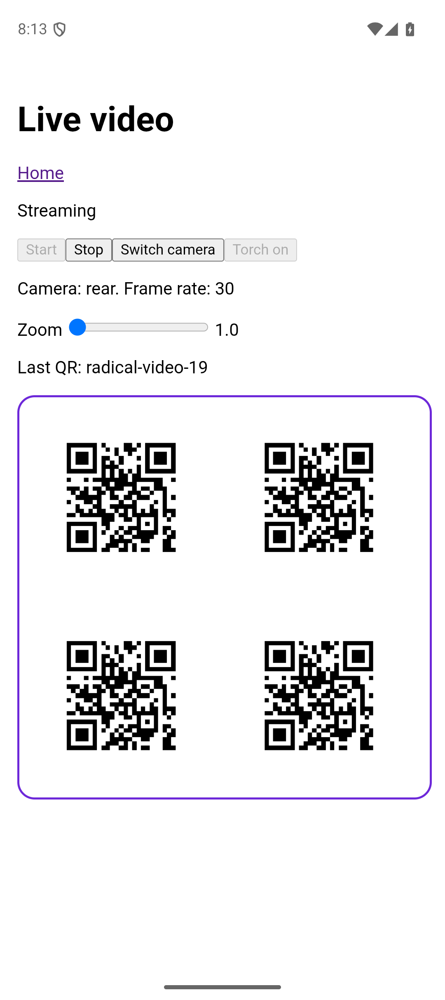

# Live video verification

Verified on 2026-10-22 with Capacitor 8.5.3 and `@capgo/camera-preview@8.14.2`. Both devices were opened through the T3 Device panel, one at a time. During the initial verification, the pinned device CLI returned `Error (COMMAND_FAILED): Remote daemon is unavailable` on both platforms. That verification therefore used adb, simctl, screenshots, and the shells' WebView debuggers. No diagnostic code or generated native project is committed.

## Build commands

The example resolves radical from dist. Built it first with `vp run radical#build`, generated both shells with `pnpm --filter @radical/example exec radical android --generate-only` and `pnpm --filter @radical/example exec radical ios --generate-only`, then built the example with `vp run @radical/example#build`. Served the example in remote mode with `pnpm --filter @radical/example exec vp preview --host 0.0.0.0 --port 4173`.

Android build, from `apps/example/.radical/android/android`:

```sh
JAVA_HOME='/Applications/Android Studio.app/Contents/jbr/Contents/Home' ./gradlew assembleDebug
```

iOS build, from the repository root:

```sh
xcodebuild -project apps/example/.radical/ios/ios/App/App.xcodeproj \
	-scheme App -configuration Debug -sdk iphonesimulator \
	-destination id=88BEE7A3-757E-40C4-A789-5E3259B6B673 \
	-derivedDataPath apps/example/.radical/ios/build build
```

Both native builds succeeded. Generated projects include the pinned CameraPreview plugin. Camera permission and the configured explanation are present; streaming requests disable audio.

## Pixel_9, Android 16

Installed the debug APK and forwarded port 4173 with `adb reverse`. Used accessibility bounds from `uiautomator dump` for taps and `adb exec-out screencap -p` for screenshots. Read page state and inline styles through the WebView's DevTools socket.

- Opened **Live video and QR scanning**, then **Start**. The page displayed **Streaming**, rear camera, and 30 fps. The emulator's checkerboard camera output showed through the bordered cut-out while the HTML controls remained opaque and interactive.
- The first screenshot revealed that the upstream default 4:3 preview ended halfway down the cut-out. Passing `aspectRatio: "fill"` made the preview fill the entire cut-out.
- **Switch camera** changed the state to front and retained a live preview. Both emulated cameras reported a zoom range of 1 to 1 and only the `off` flash mode. Torch stayed disabled. Optical zoom and torch illumination cannot be verified on this emulator.
- The first Stop attempt exposed Capacitor's `removeListener` contract: it returns no native promise result. Awaiting it left the session's finalizer pending. Removal now uses a fire-and-forget native callback call; a deterministic regression test asserts that removal never uses `nativePromise`.
- Stop/restart and background restoration were repeated after this fix. Stop returned the UI to **Stopped** and restored body/root inline backgrounds; restart acquired another session.
- The initial virtual-scene poster attempt showed only a checkerboard. The follow-up below verifies camera-decoded QR delivery.

The QR scene images were reset after the attempt. Screenshots of the full cut-out, stopped state, and iOS unavailable state are attached to the PR.

## Android QR follow-up

On 2026-10-22, reopened only Pixel_9 through the T3 Device panel. The pinned `agent-device` CLI worked for this run. Rebuilt radical and the example, regenerated Android, and ran `assembleDebug` with the Java home above. Installed the debug APK and served remote mode on port 4173 through `adb reverse`.

The Device panel launches the emulator with `-camera-back imagefile:/Users/akshat/.cache/serve-emu/camera/emulator-5554-back.png`, overriding the AVD's `hw.camera.back=virtualscene`. This explains why virtual-scene wall and table posters did not affect the earlier camera preview.

Generated `radical-video-19` with Python `qrcode==8.2` and Pillow in a temporary venv. Saved an RGB 1280 by 960 PNG to the back-camera feed path after backing up the original. A single centered 696-pixel QR appeared cropped and produced no detection. Replaced it with 232-pixel QR images at x positions 80, 400, 720, and 1040 and y positions 40, 360, and 680, on a white canvas. Stopped and restarted the stream to reload the image.

The real native camera pipeline decoded the image. Logcat at 08:13:13 showed `CameraPreview: Notifying listeners for event barcodeScanned` followed by barcode results with `value: "radical-video-19"` and `format: "qr_code"`. The unmodified `/video` route's `onDetect: setLastQR` callback updated the displayed text to **Last QR: radical-video-19**. The accessibility snapshot confirmed **Streaming**, **Camera: rear. Frame rate: 30**, and the decoded value. No bridge event or detection result was injected.



Stopped the stream, restored the original camera PNG, removed the port reverse, stopped preview, and closed and shut down Pixel_9 through the Device panel. This verifies Android QR detection from emulator camera frames. Physical camera optics remain outside this emulator check.

## iPhone Duo, iOS 27.1 simulator

Installed and launched the built app on `88BEE7A3-757E-40C4-A789-5E3259B6B673` with simctl. The Duo has multiple displays: the default screenshot selected a black secondary screen. `simctl io ... screenshot --display=1` captured the app on its primary screen.

Because the device daemon was unavailable, used LLDB to evaluate DOM navigation and the existing Start button's click in the shell's WKWebView. This exercised the actual hook and native plugin; no native results were replaced. The `/video` route rendered idle. Start displayed **Unavailable**, with Start enabled and Stop, Switch camera, and Torch disabled. The simulator has no camera devices, so it cannot verify a live cut-out, QR detection, switching, zoom, torch, or actual frame rate. Physical iPhone verification remains required for those behaviors.

## Automated checks

`pnpm exec ultracite fix`, `pnpm exec ultracite check`, `vp run ready`, and `pnpm install --frozen-lockfile` pass. The ready suite includes 249 tests. The lockfile contains no `@pnpm/exe` entries.

Video tests use `it.effect`, `assert`, per-test bridge/browser layers, Deferred synchronization, and TestClock. They cover QR callbacks and filtering, command arguments, switching and state, permission denial, missing cameras, interrupted native startup, failed startup cleanup, late browser acquisition cleanup, background longhand restoration, fire-and-forget listener removal, duplicate hook starts, stop/restart, unmount, provider replacement with retired actions and callbacks, and SSR guards. They use no real camera, network, or timers. Browser preview and BarcodeDetector behavior on physical browser hardware remain unverified.
